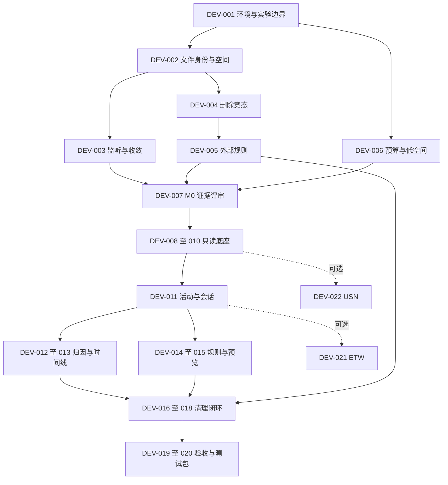

# 任务计划：CClean 按开发顺序实施

## 元信息

- 计划 ID：`CCLEAN-20260917-DEV`
- 创建时间：`2026-09-17T16:08:28+08:00`
- 状态：**执行中；用户已通过 do-plan 授权实施**。
- 来源基线：`44cd8c4`；规划前工作区干净，`main` 与 `origin/main` 一致。
- 复杂度：高；22 个任务，其中 P0 必做 20 个，P1 可选增强 2 个。
- 当前下一项：**DEV-019 性能整改（内存未通过）；DEV-013/017/018/020 保留待验，内部包可审阅**。
- 本地任务表：[2026-09-17_cclean-development.tasks.json](2026-09-17_cclean-development.tasks.json)。
- MCP 同步：**未同步**。当前工具目录没有任务管理与全局经验检索接口，远端任务 ID 均为空；本地清单已准备，不把文件保存或 GitHub 提交当作 MCP 同步。
- 当前文件变更范围：已进入实施，包含源代码、测试、探针和研究记录；完成情况以各步骤实测记录为准。

## 任务目标与背景

依照现有开发顺序完成“发现 C 盘增长 → 关联项目与会话 → 可视化 → 预览 → 受控清理 → 实测结果”的 Windows 桌面闭环，并能对 Codex、Claude Code、ZCode 进行基础会话和目录监测。

已有 7 份 Markdown 规划与 GitHub 私有仓库，尚无 `src/`、`tests/`、`tools/`、解决方案或 SDK 锁定文件。本次检查在 PATH 与标准安装位置未发现 .NET SDK；实际执行时需重新核实。此前目录监听、删除安全、外部规则和性能均未运行 PoC。

现有依据：

- [产品需求](../../../docs/01-product-requirements.md)
- [技术架构](../../../docs/02-architecture.md)
- [安全清理协议](../../../docs/03-cleanup-safety.md)
- [界面与交互](../../../docs/04-ux-flows.md)
- [阶段计划与 AT 验收矩阵](../../../docs/05-delivery-plan.md)
- [未决事项和官方来源](../../../docs/06-decisions-and-sources.md)

以下列出的代码、测试、PoC 和研究文件均是**拟在执行阶段新增**；现有 `docs/01–06` 为后续可更新的依据文件。它们此刻不存在，不应点击执行命令后将失败误认为应用回归。

## 规划边界与技术决定

1. 推荐方案保持 C# / .NET 10 LTS + WPF + SQLite。SDK 真实补丁版本由 DEV-001 安装/检测后锁定。xUnit 与测试 SDK 仅是开发验证依赖，不增加生产框架。
2. M0 建立可复用 Core + PoC runner + 关键测试；M1 直接接入 WPF，不丢弃探针重写一套。
3. 目录监听只作为状态变化提示；空间、写请求字节与进程证据保持独立。ETW/USN 是可选增强，不阻塞普通 MVP。
4. 清理必须先预览，所有入口保护活跃项目、未知来源、凭据/会话、源码、特殊对象及越界路径。外部规则只有经验证且用户启用才可进入候选。
5. G3 要求真实外部独占缓存的一键规则，不能以“自身日志”或“共享缓存逐次确认”替代。依赖专用缓存配置的规则必须显式说明使用条件。
6. 延续用户已授权的 GitHub 同步，计划和后续验收代码可提交到现有私有仓库；不包含公开发行或购买签名证书。

## 历史教训查询与此次评审结论

- 项目级：未发现 `.codex/lessons/`，因此没有可引用的本地经验条目。
- 全局级：没有可调用的 `search_nodes`，属于**未能查询**，不等于全局库没有相关经验。
- 本次需求评审发现：回收站不等于释放空间；相同路径可能换成新文件；ADS/链接必须进入保护；G2 还需正常删除成功样例；G3 必须验证用户需要的一键价值。它们是本项目评审结论，不伪称历史经验库记录。

## 顺序、并行与准入规则

图表示里程碑；精确任务依赖以任务表为准。单执行者按前置条件选择最小编号的就绪 P0 任务；并行只用于文件责任互不冲突的工作，合并由主执行者完成。

- DEV-002/DEV-006 在环境就绪后可并行；DEV-003 与 DEV-004 在文件身份基础就绪后可并行。
- DEV-007 等待前置任务有终态结果后汇总，包括失败/阻塞。**评审完成不等于 G1–G4 全通过，也不等于 M0 全部完成。**
- 只读链路 DEV-008 需要 G1、文件身份基线、G4 预算验证通过；G2/G3 失败只阻塞真实清理链路及完整 MVP，不阻止已具备条件的只读工作。
- DEV-014/DEV-015 可与 DEV-012/DEV-013 并行；外部规则未通过时，预览仅用明确的合成 fixture 验证，真实规则保持禁用。
- DEV-016 额外要求 G2/G3 通过；DEV-017 还依赖时间线完成。
- DEV-021/DEV-022 默认延后，MVP 完成不要求它们通过；如果纳入发行，集成后重跑受影响的权限、性能和归因测试。

## 工作量与阶段输出

| 阶段 | 任务 | 估算 | 验收里程碑 |
| --- | --- | --- | --- |
| M0 | DEV-001～007 | 5–8 人日 | 实测 G1/G2/G3 与预算证据，定版支持边界 |
| M1 | DEV-008～010 | 4–6 人日 | 普通权限下只读发现、监测、容量和索引 |
| M2 | DEV-011～013 | 5–7 人日 | 三工具基础会话、证据分类和时间线 |
| M3 | DEV-014～015 | 4–6 人日 | 保护规则、一次性清单与 dry-run |
| M4 | DEV-016～018 | 5–8 人日 | 外部一键清理、安全审计与恢复 |
| M5 | DEV-019～020 | 4–6 人日 | P0 验收与可追溯 Windows 内部测试包 |
| M6 | DEV-021～022 | 另计 5–8 人日 | ETW/USN 增强，失败可回退 |

本次细化估算为 **27–41 个工程人日，约 6–9 周单人全职投入**；相较既有 26–39 人日估算，增加了环境准备、可重复对抗实验和规则验证余量。这不是排期承诺；不把并行人数直接换算成倍速。SDK/下载、证书采购和外部工具的不确定等待另行记录。

## 验证命令的统一契约

下列命令是**执行阶段必须实现的验收接口**，不是当前已有程序。DEV-001 建立工程和 runner，后续任务增加相应 `--case`。先检查能力存在；场景未知、未选中任何测试或必需条件缺失都不得返回成功。

- PoC 退出码：`0` 全部必测通过，`1` 验收失败，`2` 必需环境/能力缺失，`3` 实验范围保护拒绝。
- JSON 结果包含实际 SDK/OS、代码提交、运行 ID、开始/结束、样本规模、passed/failed/skipped、缺口/异常、资源峰值与退出码。必测场景 skipped 不能算通过。
- 每次实际输出使用唯一运行子目录，以下 `artifacts/...` 是报告目标示例；不覆盖既有运行证据。原始实验和日志被已有 `.gitignore` 排除，仓库仅存脱敏摘要。
- 测试统一使用 `Category` trait，可同时标记 `M0`、`Safety`、`Foundation`、`MvpP0`。Foundation 仅覆盖只读底座的必要验证；MvpP0 覆盖全部必做产品验收，P1 权限实验独立报告。命令必须确认选中数量大于 0，规划不预填虚假的通过次数。
- 默认实验总预算 256 MiB。`--max-fixture-bytes` 显式设置实验数据总预算，`--reserve-free-bytes` 是运行期间必须保留的系统可用量；预估分配加保留量不足时拒绝开始并在运行中复查。超过默认预算必须选择经过核实的非系统 NTFS 实验根。DEV-006/019 提供正向命令；默认条件不足、无独立卷时返回 `2`，路径越界或归属校验失败返回 `3`。不能偷偷放宽上限或写满 C 盘。
- 每项先执行相关验证；通过后只在新改动、失败或未消除疑点需要时复跑，不重复全部无关测试。

## 详细任务
### DEV-001 · M0 · 建立 SDK、实验边界和最小可复用工程

- **状态**：已完成 ✓（P0；via sub-001-environment；构建及 9 项测试、6 个 CLI 场景通过）。
- **依赖**：无。
- **涉及文件**：`global.json`（拟新增）；`CClean.slnx`（拟新增）；`src/CClean.Core/CClean.Core.csproj`（拟新增）；`tools/CClean.Poc/CClean.Poc.csproj`（拟新增）；`tools/CClean.Poc/Program.cs`（拟新增）；`tests/CClean.Tests/CClean.Tests.csproj`（拟新增）。
- **目标与操作**：
  1. 重新探测 .NET 10 x64 SDK；缺失时使用 Microsoft 官方发行源安装，按实际稳定版本写 global.json，不填写虚构补丁版本。
  2. 建立 Core、单一 PoC runner 与 xUnit 测试工程；暂不创建 WPF 空页面。只增加必要的测试依赖。
  3. PoC 统一提供 --case、--sandbox、--output 参数，创建独立实验根标记并校验真实路径、卷和容量；清理仅针对本次生成且带标记的对象。小型测试默认总量不超过 256 MiB。
  4. 大规模数据优先放在重新核实的非系统 NTFS 卷或隔离虚拟机；C 盘只做受限小型用例，不以填满 C 盘测试低空间。
  5. SDK 安装包、NuGet 下载和实验输出采用显式目录与容量检查；不默认依赖 winget 可用，不擅自更换技术栈。
  6. 统一支持 --max-fixture-bytes、--reserve-free-bytes、--file-count、--logical-bytes；实验根必须新建或带本计划归属标记。超过默认 256 MiB 的实验必须显式选择非系统 NTFS 卷并通过容量守卫。
- **验证方法**：
  - `dotnet --info`
  - `dotnet build CClean.slnx -c Release`
  - `dotnet run --project tools/CClean.Poc -- --case environment --sandbox artifacts/m0/sandbox --output artifacts/m0/environment.json`
- **完成条件**：记录 SDK/OS/架构/卷与实验上限；越界根、既有非实验目录、链接和容量不足均拒绝；Core 与 runner 可构建，未执行任何真实缓存删除。
- **失败处理**：SDK 或实验盘条件不满足时记录具体环境问题，不以空报告通过；可继续不依赖运行环境的资料审查。
- **需求/验收映射**：`T00`、`G2`。

### DEV-002 · M0 · 验证文件身份、特殊对象和空间计量

- **状态**：已完成 ✓（P0；via sub-002-metadata；5 项测试、12 项 PoC 检查通过）。
- **依赖**：`DEV-001`。
- **涉及文件**：`src/CClean.Core/Files/WindowsFileMetadata.cs`（拟新增）；`src/CClean.Core/Storage/VolumeSpaceReader.cs`（拟新增）；`tests/CClean.Tests/FileMetadataTests.cs`（拟新增）；`docs/research/storage-poc.md`（拟新增）。
- **目标与操作**：
  1. 从句柄读取卷标识、File ID、大小和分配信息，区分当前用户可用量与卷剩余量。
  2. 构造硬链接、junction、符号链接、ADS、压缩/稀疏、中文/长路径、ACL 拒绝用例；涉及额外权限的测试明确单列。
  3. 硬链接去重；链接不跟随；命名数据流、特殊或无法检查对象标记不完整并排除清理。
- **验证方法**：
  - `dotnet run --project tools/CClean.Poc -- --case metadata --sandbox artifacts/m0/sandbox --output artifacts/m0/metadata.json`
  - `dotnet test tests/CClean.Tests --filter Category=FileMetadata`
- **完成条件**：普通对象身份可稳定读取；不同别名不重复累计；未知不计为零；被跳过的管理员场景明确列出，不能算通过。
- **失败处理**：不支持的对象类型保持只读和显式排除；若普通 NTFS 对象身份不可靠，G2 不放行。
- **需求/验收映射**：`AT-06`、`AT-09`、`AT-19`、`G2`。

### DEV-003 · M0 · 验证目录监听、溢出和最终状态收敛

- **状态**：已完成 ✓（P0；via sub-003-monitoring；真实溢出与 12,001 文件收敛通过）。
- **依赖**：`DEV-002`。
- **涉及文件**：`src/CClean.Core/Monitoring/DirectoryMonitor.cs`（拟新增）；`src/CClean.Core/Monitoring/DirectoryScanner.cs`（拟新增）；`tests/CClean.Tests/MonitoringTests.cs`（拟新增）；`docs/research/monitoring-poc.md`（拟新增）。
- **目标与操作**：
  1. 复用 Core 完成最小元数据枚举与 FileSystemWatcher；先监听再扫描、归并提示并校准，不保存无界原始事件。
  2. 受控制造创建、追加、覆盖、截断、重命名、整目录移动和删除，按静默期独立枚举检查结果。
  3. 同时覆盖应用队列溢出和底层通知溢出；底层未实际触发时标记未验证，不能用注入错误代替实测。
- **验证方法**：
  - `dotnet run --project tools/CClean.Poc -- --case watcher --sandbox artifacts/m0/sandbox --output artifacts/m0/watcher.json`
  - `dotnet run --project tools/CClean.Poc -- --case watcher-overflow --sandbox artifacts/m0/sandbox --output artifacts/m0/watcher-overflow.json`
  - `dotnet test tests/CClean.Tests --filter Category=Monitoring`
- **完成条件**：受控集合最终路径与大小 100% 一致；缺口可见且不会被补扫抹去。大集合静默后目标 60 秒内恢复，环境和规模随报告保存；小集合通过不替代规模目标。
- **失败处理**：优先缩小监听范围、修复队列与补扫；历史不可恢复就保留缺口，不捏造写入序列。
- **需求/验收映射**：`FR-03`、`AT-01`、`AT-02`、`G1`。

### DEV-004 · M0 · 验证按已核实文件对象删除及竞态防护

- **状态**：已完成 ✓（P0；via sub-004-deletion；30 轮对抗、30 正常删除、150 对象保护通过）。
- **依赖**：`DEV-001`、`DEV-002`。
- **涉及文件**：`src/CClean.Core/Cleanup/VerifiedFileDeletion.cs`（拟新增）；`tests/CClean.Tests/DeletionSafetyTests.cs`（拟新增）；`docs/research/cleanup-poc.md`（拟新增）。
- **目标与操作**：
  1. 仅在实验沙箱实现同句柄元数据复核与删除，验证祖先边界、共享写入/删除限制和特殊对象排除。
  2. 用可控同步点制造叶子替换、祖先替换、新增文件/ADS、路径前缀混淆和文件占用；不能只靠睡眠碰运气。
  3. 记录实验前后保护对象身份与内容校验值，独立确认没有清单外删除；产品执行入口仍不开放。
- **验证方法**：
  - `dotnet run --project tools/CClean.Poc -- --case deletion-safety --sandbox artifacts/m0/sandbox --output artifacts/m0/deletion-safety.json`
  - `dotnet test tests/CClean.Tests --filter Category=DeletionSafety`
- **完成条件**：G2：正常批准的普通缓存文件必须成功删除；重复对抗用例中保护对象、未知对象和清单外对象误删为 0。不稳定对象必须跳过，但不能以全部跳过冒充通过。
- **失败处理**：关闭删除能力并修复复核点；普通只读工作可继续，不降低保护换取通过。
- **需求/验收映射**：`G2`、`AT-05`、`AT-06`、`AT-07`、`AT-09`、`AT-19`、`AT-20`。

### DEV-005 · M0 · 确定三工具适配范围和真实外部一键缓存规则

- **状态**：已完成 ✓（P0；via sub-005-cache；独立 npm 缓存真实重建通过）。
- **依赖**：`DEV-001`、`DEV-004`。
- **涉及文件**：`src/CClean.Core/Tools/ToolDefinition.cs`（拟新增）；`src/CClean.Core/Cleanup/CacheRule.cs`（拟新增）；`tests/CClean.Tests/CacheRuleCompatibilityTests.cs`（拟新增）；`docs/research/tool-compatibility.md`（拟新增）。
- **目标与操作**：
  1. 记录 Codex、Claude Code、ZCode 的测试版本与 A/B/C 能力级别；不读取聊天、凭据或未经证实的内部数据库。
  2. 先调查三工具已证实的独占可重建缓存；若无可支持对象，验证真实开发工具显式配置的独立缓存根，例如 npm 的独立 cache。默认全局缓存始终标为共享。
  3. 由真实工具在隔离根生成缓存，按 DEV-004 对象方案清理后重新运行验证重建；未知版本、活跃消费者、共享根和新文件均测试排除。
  4. 冻结至少一条可进入常规一键的外部规则：可靠发现方式、版本、独占依据、活动排除、执行粒度和重建代价。不得为过关把普通临时文件改叫外部缓存。
  5. 若规则依赖用户显式配置独立缓存根，必须把该前置条件写入兼容表和界面；不能静默改变用户工作流，也不能宣称默认共享缓存已支持一键。
- **验证方法**：
  - `dotnet run --project tools/CClean.Poc -- --case cache-rule --sandbox artifacts/m0/sandbox --output artifacts/m0/cache-rule.json`
  - `dotnet test tests/CClean.Tests --filter Category=CacheCompatibility`
- **完成条件**：G3：至少一个真实外部独占缓存规则可安全进入常规一键；三目标工具均有明确基础能力与未支持项，不能只凭目录名判断可删除。
- **失败处理**：限定 1–1.5 人日完成第一轮候选验证；无可行规则就输出证据和未完成门槛，继续只读链路，不用共享手动清理或自身日志替代。
- **需求/验收映射**：`FR-13`、`FR-14`、`G3`、`AT-04`、`AT-15`。

### DEV-006 · M0 · 验证数据库预算、WAL 与低空间降级

- **状态**：已完成 ✓（P0；via sub-006-budget；WAL 与真实磁盘满通过）。
- **依赖**：`DEV-001`。
- **涉及文件**：`src/CClean.Core/Storage/RuntimeBudget.cs`（拟新增）；`tests/CClean.Tests/RuntimeBudgetTests.cs`（拟新增）；`docs/research/storage-budget-poc.md`（拟新增）。
- **目标与操作**：
  1. 用 Microsoft.Data.Sqlite 验证批量写入、长读事务、WAL 增长和 checkpoint，记录真实文件总占用。
  2. 通过受控故障注入验证空间不足和审计写失败，再在隔离限额环境验证实际 I/O 失败；禁止把开发机 C 盘写满。
  3. 验证 DB+WAL+SHM 300 MiB、日志 50 MiB、临时文件 20 MiB、总运行数据 400 MiB 的守卫；低空间禁止大 VACUUM。
  4. 正向压力使用非系统 NTFS 实验根、1 GiB 上限并保留 10 GiB 空间；默认 256 MiB 不足时的拒绝作为单独负向测试。D 盘执行时重验，不存在或不足则换经核实的非系统实验卷并记录。
- **验证方法**：
  - `dotnet run --project tools/CClean.Poc -- --case storage-budget --sandbox D:/CCleanLab/CCLEAN-20260917-DEV/storage-budget --max-fixture-bytes 1073741824 --reserve-free-bytes 10737418240 --output artifacts/m0/storage-budget.json`
  - `dotnet test tests/CClean.Tests --filter Category=RuntimeBudget`
- **完成条件**：达到预算前开始降级，不因长事务无限涨 WAL；审计不可写时拒绝新删除；注入测试和真实限额测试结果分别标注。 M0 只验证 G4 的预算与失败部分，完整 UI CPU/内存目标仍待 DEV-019。
- **失败处理**：先限制采集与扩展索引，保留容量查询；修复预算前不推进清理执行集成。
- **需求/验收映射**：`FR-12`、`NFR-05`、`AT-13`、`G4`。

### DEV-007 · M0 · 汇总 M0 证据并确定后续任务准入

- **状态**：已完成 ✓（P0；22 项 M0 测试通过，证据评审完成）。
- **依赖**：`DEV-003`、`DEV-002`、`DEV-004`、`DEV-005`、`DEV-006`；等待终态结果，不要求所有门槛通过。
- **涉及文件**：`docs/research/m0-decision.md`（拟新增）；`docs/02-architecture.md`（既有，执行时更新）；`docs/05-delivery-plan.md`（既有，执行时更新）；`docs/06-decisions-and-sources.md`（既有，执行时更新）。
- **目标与操作**：
  1. 逐一汇总 G1–G4 为通过/失败/未验证，关联测试版本、原始结果的脱敏摘要和复现命令。
  2. 冻结技术栈、规则支持范围及测试基线；对不成立的目标记录实际结果和调整理由。
  3. 只读链路只依赖其必要前置；任何 G2/G3 未通过都阻止完整清理 MVP，而非停止一切独立工作。
  4. 全量 M0 测试的非零退出码是本任务的评审输入；必须如实记录失败/缺失，而非强求所有测试通过。评审任务按证据是否完整、门槛和后继状态是否准确判定完成。
- **验证方法**：
  - `dotnet test tests/CClean.Tests --filter Category=M0`
  - 逐项核对 m0-decision.md 与 PoC JSON，确认 skipped 未被当成 passed
- **完成条件**：每个门槛有证据和明确影响；不含真实私密路径、文件内容或假通过记录；后续任务状态与门槛一致。 本任务完成表示评审完成，不表示所有门槛通过或 M0 全部完成。
- **失败处理**：按失败门槛回到对应任务；常规修复由执行者处理，不为每次重试再次索要确认。
- **需求/验收映射**：`G1`、`G2`、`G3`、`G4`。

### DEV-008 · M1 · 建立 WPF 外壳、项目配置和 Windows CI

- **状态**：已完成 ✓（P0；via sub-008-app；受限权限桌面与 Windows CI 通过）。
- **依赖**：`DEV-007`；附加门槛 G1:passed、MetadataBaseline:passed、G4Budget:passed。
- **涉及文件**：`src/CClean.App/CClean.App.csproj`（拟新增）；`src/CClean.App/App.xaml`（拟新增）；`src/CClean.App/MainWindow.xaml`（拟新增）；`.github/workflows/ci.yml`（拟新增）。
- **目标与操作**：
  1. 复用 M0 Core，加入 WPF App、基本导航、错误呈现和普通权限启动；不引入 Web 服务。
  2. 建立 Windows 构建与无破坏性测试 CI，固定 SDK 与必要依赖。
  3. 后台操作支持取消，主线程不执行目录枚举；真实删除入口保持关闭。
  4. Foundation 分类仅覆盖环境、元数据、监测、预算和只读 WPF 基础；G2/G3 研究测试保留独立失败记录，不作为只读链路必过 CI。
- **验证方法**：
  - `dotnet build CClean.slnx -c Release`
  - `dotnet test tests/CClean.Tests -c Release --filter Category=Foundation`
  - Windows 普通用户运行 App；检查 CI 对应提交结果
- **完成条件**：普通模式可启动、切换页面、显示错误，CI 构建与受控测试通过；无需管理员才能进入主界面。
- **失败处理**：保留 Core/PoC 可运行，修复 WPF/CI 配置；不扩大框架范围。
- **需求/验收映射**：`FR-01`、`NFR-01`。

### DEV-009 · M1 · 集成目录发现、持续监测和覆盖状态

- **状态**：已完成 ✓（P0；via sub-009-discovery；发现/登记/暂停/重启/恢复桌面流程通过）。
- **依赖**：`DEV-008`。
- **涉及文件**：`src/CClean.Core/Projects/ProjectRegistry.cs`（拟新增）；`src/CClean.Core/Monitoring/DirectoryDiscovery.cs`（拟新增）；`src/CClean.App/Views/ProjectSetupView.xaml`（拟新增）；`tests/CClean.Tests/DiscoveryTests.cs`（拟新增）。
- **目标与操作**：
  1. 增加用户确认范围内的限额只读发现，单批 30 秒或 100,000 对象，支持继续与取消。
  2. 登记跨盘项目与 C 盘缓存，去重重叠根；发现结果需用户确认才持续监测，不能自动授权清理。
  3. 集成补扫、暂停、重启恢复与完整性状态；不能把访问失败显示为 0 B。
- **验证方法**：
  - `dotnet test tests/CClean.Tests --filter Category=Discovery`
  - 执行 AT-01、AT-02、AT-03、AT-21 的桌面流程
- **完成条件**：用户无需预先知道所有缓存路径即可发现候选；覆盖和历史缺口明确；C 盘数据不会混入其他卷占用。
- **失败处理**：限制根目录/队列并修复补扫；保存已完成覆盖，不以无限扫描解决。
- **需求/验收映射**：`FR-02`、`FR-03`、`AT-03`、`AT-21`。

### DEV-010 · M1 · 落地索引、容量总览和自身资源守卫

- **状态**：已完成（P0；证据 docs/research/index-storage.md；最终性能待 DEV-019）。
- **依赖**：`DEV-008`、`DEV-009`。
- **涉及文件**：`src/CClean.Core/Storage/LocalStore.cs`（拟新增）；`src/CClean.App/Views/OverviewView.xaml`（拟新增）；`src/CClean.App/Views/FilesView.xaml`（拟新增）；`tests/CClean.Tests/LocalStoreTests.cs`（拟新增）。
- **目标与操作**：
  1. 将 PoC 预算方案接入正式索引、迁移、批量写入和保留策略，区分可重建索引与清理审计。
  2. 实现容量采样、当前占用/净增长、未知计量与范围说明，文件列表虚拟化。
  3. 紧急空间模式暂停扩展扫描与历史落盘，仍保留容量查询和已有索引；相同容量预算约束所有辅助文件。
- **验证方法**：
  - `dotnet test tests/CClean.Tests --filter Category=Storage`
  - 执行 100,000 文件扫描与 10 分钟空闲资源测量，记录规模、耗时和预算
- **完成条件**：FR-01～03、FR-12 的只读闭环可用；资源目标实测或明确差距，未开放删除。
- **失败处理**：先降采集量/索引粒度，再调优；不能隐藏不完整范围。
- **需求/验收映射**：`FR-01`、`FR-07`、`FR-12`、`AT-13`。

### DEV-011 · M2 · 实现会话、工具基础适配与活动保护

- **状态**：已完成（P0；证据 docs/research/sessions.md）。
- **依赖**：`DEV-010`。
- **涉及文件**：`src/CClean.Core/Sessions/SessionRegistry.cs`（拟新增）；`src/CClean.Core/Tools/ToolCatalog.cs`（拟新增）；`src/CClean.App/Views/SessionsView.xaml`（拟新增）；`tests/CClean.Tests/SessionTests.cs`（拟新增）。
- **目标与操作**：
  1. 实现手动会话的开始、结束、异常中断与恢复，三工具全部支持 A 级目录/标签绑定。
  2. 对经验证版本逐步启用进程绑定，使用 PID + 启动时间，不把进程树直接等同聊天会话。
  3. 形成所有已登记项目、会话及关联依赖的活动保护快照；显式结束不自动变成可删除。
- **验证方法**：
  - `dotnet test tests/CClean.Tests --filter Category=Sessions`
  - 逐个演示 Codex、Claude Code、ZCode 的登记与手动会话；执行 AT-08
- **完成条件**：三工具的基础模式均可用；版本未支持时明确降级；进程复用和多会话不误判。
- **失败处理**：回退手动绑定，保留未知/保护状态；不读取私有数据库凑自动识别。
- **需求/验收映射**：`FR-04`、`FR-13`、`AT-08`、`AT-15`。

### DEV-012 · M2 · 实现证据分类、共享去重和时间聚合查询

- **状态**：已完成（P0；证据 docs/research/attribution.md）。
- **依赖**：`DEV-011`。
- **涉及文件**：`src/CClean.Core/Attribution/AttributionRules.cs`（拟新增）；`src/CClean.Core/History/TimelineQuery.cs`（拟新增）；`tests/CClean.Tests/AttributionTests.cs`（拟新增）。
- **目标与操作**：
  1. 分别保存进程证据、上下文关联、共享、未知；普通监听没有 PID 时不显示进程证实。
  2. 按会话/目录/时间桶聚合，保证全局占用只统计一次，项目可显示共享关联。
  3. 保留初始存量、监测缺口和保留期边界；历史节点不能直接作为当前删除清单。
- **验证方法**：
  - `dotnet test tests/CClean.Tests --filter Category=Attribution`
  - 两个并发会话写共享目录，检查汇总不重复、未知不强分配
- **完成条件**：FR-05 的证据与指标语义一致；受控共享用例不出现虚假独占量。
- **失败处理**：保留未知和共享，不以百分比或随机分摊掩盖归因不足。
- **需求/验收映射**：`FR-05`、`AT-04`。

### DEV-013 · M2 · 完成分支时间线、详情和空间筛选

- **状态**：待完整验收（P0；子计划 sub-013-timeline；键盘/主题/导航及离屏缩放已实测，系统 DPI 与端到端 P95 未验证）。
- **依赖**：`DEV-012`。
- **涉及文件**：`src/CClean.App/Views/TimelineView.xaml`（拟新增）；`src/CClean.App/Controls/TimelineCanvas.cs`（拟新增）；`src/CClean.App/ViewModels/TimelineViewModel.cs`（拟新增）；`tests/CClean.Tests/TimelineQueryTests.cs`（拟新增）。
- **目标与操作**：
  1. 实现项目泳道、会话分支、聚合文件变化节点及独立的共享/未知行。
  2. 加入时间/项目/工具/证据筛选、节点详情和列表替代入口；最多 500 个可见节点。
  3. 展示扫描中、缺口、过期和无权限状态；支持键盘、DPI 与减少动画。
- **验证方法**：
  - `dotnet test tests/CClean.Tests --filter Category=Timeline`
  - `dotnet run --project src/CClean.App`
  - 执行 AT-17：大量节点、125%/150%/200% DPI、键盘与空/错状态
- **完成条件**：用户可从空间增长追到文件与依据；不误解成 Git 内容回滚；P95 更新目标和资源消耗有记录。
- **失败处理**：优先扩大时间桶和虚拟化，保留列表入口，不渲染无界节点。
- **需求/验收映射**：`FR-06`、`FR-07`、`AT-17`。

### DEV-014 · M3 · 实现版本化规则和所有入口的保护分类

- **状态**：已完成（P0；子计划 sub-014-protection；Protection/Storage 4 项通过）。
- **依赖**：`DEV-010`、`DEV-011`、`DEV-002`。
- **涉及文件**：`src/CClean.Core/Cleanup/ProtectionPolicy.cs`（拟新增）；`src/CClean.Core/Cleanup/RuleCatalog.cs`（拟新增）；`tests/CClean.Tests/ProtectionPolicyTests.cs`（拟新增）。
- **目标与操作**：
  1. 实现源码、凭据、Agent 历史、系统目录、活跃依赖、未知来源与特殊文件排除，手动和一键共用规则。
  2. 外部规则启用以 DEV-005 通过为前提；未通过时只能使用合成规则测试，产品外部规则不启用。
  3. 共享缓存与独占缓存分流，默认外部规则关闭，全选不能绕过保护。
- **验证方法**：
  - `dotnet test tests/CClean.Tests --filter Category=Protection`
  - 执行 AT-04、AT-16、AT-19、AT-20 的逐项与全选路径
- **完成条件**：每项分类有规则和排除依据；任何入口均不能把未知/活跃/特殊对象放进可执行集合。
- **失败处理**：不确定项保守排除，修复共享规则；禁止临时弹窗绕过。
- **需求/验收映射**：`FR-08`、`AT-20`。

### DEV-015 · M3 · 生成一次性清理清单与 dry-run 界面

- **状态**：已完成（P0；子计划 sub-015-preview；实际全选 7 项全部受保护，测试通过）。
- **依赖**：`DEV-014`、`DEV-002`。
- **涉及文件**：`src/CClean.Core/Cleanup/CleanupPlanner.cs`（拟新增）；`src/CClean.App/Views/CleanupPreviewView.xaml`（拟新增）；`tests/CClean.Tests/CleanupPlanTests.cs`（拟新增）。
- **目标与操作**：
  1. 清单绑定文件身份、数据流检查、元数据、规则/保护版本、执行动作和 5 分钟有效期。
  2. 实现接收当前文件对象选择的预览契约，先接文件列表手动选择与已启用规则批量入口；显示估算不确定性、排除原因、永久删除和重建影响。图节点实际接线在依赖时间线的 DEV-017 完成。
  3. 只执行 dry-run；预览后新文件不自动入单，历史节点先重新获取当前对象。
- **验证方法**：
  - `dotnet test tests/CClean.Tests --filter Category=CleanupPlan`
  - 从单文件与一键两个入口执行 AT-07、AT-10、AT-20
- **完成条件**：相同状态的预览集合可复现，条件变化使清单失效，预览不会触发真实删除。
- **失败处理**：修复清单/活动版本与身份绑定，不通过则保持执行器关闭。
- **需求/验收映射**：`FR-09`、`AT-07`、`AT-10`。

### DEV-016 · M4 · 集成受控执行器与可持久化审计

- **状态**：已完成（P0；执行与安全回归通过，见 cleanup-execution.md）。
- **依赖**：`DEV-004`、`DEV-005`、`DEV-007`、`DEV-015`；附加门槛 G2:passed、G3:passed。
- **涉及文件**：`src/CClean.Core/Cleanup/CleanupExecutor.cs`（拟新增）；`src/CClean.Core/Cleanup/CleanupJournal.cs`（拟新增）；`tests/CClean.Tests/CleanupExecutionTests.cs`（拟新增）。
- **目标与操作**：
  1. 只有 G2/G3 通过并记录后才开产品执行器，复用同句柄删除方案。
  2. 实现单任务租约、批准范围绑定、逐项重新校验，执行前及项间持久化审计。
  3. 变化、占用、权限失败时跳过；不强杀进程、不提权强删；取消只影响后续项。
- **验证方法**：
  - `dotnet test tests/CClean.Tests --filter Category=CleanupExecution`
  - `dotnet test tests/CClean.Tests --filter Category=DeletionSafety`
- **完成条件**：执行严格限于批准对象；失效项跳过；不可审计时不新删；重复点击不重复执行。
- **失败处理**：任一误删/越界即禁用执行并回到 G2；独立只读能力仍可用。
- **需求/验收映射**：`FR-10`、`FR-11`、`G2`、`G3`、`AT-05`、`AT-10`。

### DEV-017 · M4 · 完成手动与一键清理的用户闭环

- **状态**：实现完成，待完整验收（P0）。
- **依赖**：`DEV-013`、`DEV-016`。
- **涉及文件**：`src/CClean.App/Views/CleanupView.xaml`（拟新增）；`src/CClean.App/Views/CleanupHistoryView.xaml`（拟新增）；`tests/CClean.Tests/CleanupWorkflowTests.cs`（拟新增）。
- **目标与操作**：
  1. 在时间线与预览均完成后接通图节点选择，复用 DEV-015 的当前对象契约，串联发现/时间线 → 当前对象 → 预览 → 确认 → 执行 → 结果。
  2. 以真实工具在隔离环境生成独占缓存，验证常规一键规则、重建和再次开发；共享清理走独立确认。
  3. 分列删除对象估算与系统可用量变化；并发写入导致零/负变化也如实展示。
- **验证方法**：
  - `dotnet test tests/CClean.Tests --filter Category=CleanupWorkflow`
  - 在隔离工具配置上执行端到端流程，复核清理前后系统采样及工具重建结果
- **完成条件**：FR-14 实际通过，至少一条外部规则可进入常规一键；用户可以完成完整闭环且理解动作后果。
- **失败处理**：真实规则回归失败则停用该版本并回到 DEV-005，不能仅通过模拟数据验收。
- **需求/验收映射**：`FR-10`、`FR-14`、`AT-11`、`AT-15`。

### DEV-018 · M4 · 完成故障恢复、取消和清理对抗验收

- **状态**：故障测试已执行，待完整验收（P0）。
- **依赖**：`DEV-016`、`DEV-017`。
- **涉及文件**：`src/CClean.Core/Cleanup/CleanupRecovery.cs`（拟新增）；`tests/CClean.Tests/CleanupRecoveryTests.cs`（拟新增）；`docs/testing/cleanup-acceptance.md`（拟新增）。
- **目标与操作**：
  1. 在删除前、删除后审计前、项间分别注入崩溃，重启核验已知结果且不自动续删。
  2. 覆盖审计磁盘满、规则变化、项目重活动、ADS 新增、锁定文件和路径替换。
  3. 记录回收站/同盘隔离不释放容量的约束；不虚构撤销或恢复能力。
- **验证方法**：
  - `dotnet test tests/CClean.Tests --filter Category=CleanupRecovery`
  - `dotnet test tests/CClean.Tests --filter Category=Safety`
- **完成条件**：AT-05～13、AT-19～20 相关项通过；缺失对象如实标记来源不明；保护集合内容保持不变。
- **失败处理**：停用执行，修复故障点并复跑受影响用例；禁止自动继续中断清单。
- **需求/验收映射**：`FR-11`、`AT-12`、`AT-13`。

### DEV-019 · M5 · 完成性能、低空间、权限和可访问性验收

- **状态**：验收失败（P0；三轮内存超标，详见 docs/testing/release-acceptance.md）。
- **依赖**：`DEV-010`、`DEV-013`、`DEV-018`。
- **涉及文件**：`tests/CClean.Tests/PerformanceScenarios.cs`（拟新增）；`docs/testing/release-acceptance.md`（拟新增）。
- **目标与操作**：
  1. 在记录硬件/负载的环境验证 100,000 文件/20 GiB 基准、更新 P95、空闲 CPU、内存和自身预算；大数据与低空间测试在隔离环境。
  2. 普通用户、拒绝增强提权、中文长路径、高 DPI、键盘、空/错/缺口和离屏节流逐项验收。
  3. 区分合成故障注入与真实限额 I/O 失败；扫描压力、稳态与 ETW 模式分别报告。
  4. 正向 benchmark 使用重新核实的非系统 NTFS 实验根，显式设置 24 GiB 预算和 20 GiB/100,000 文件样本，保留 10 GiB 空间；MvpP0 覆盖必做验收，P1 权限实验独立报告。
- **验证方法**：
  - `dotnet test tests/CClean.Tests -c Release --filter Category=MvpP0`
  - `dotnet run --project tools/CClean.Poc -c Release -- --case benchmark --sandbox D:/CCleanLab/CCLEAN-20260917-DEV/benchmark --max-fixture-bytes 25769803776 --file-count 100000 --logical-bytes 21474836480 --reserve-free-bytes 10737418240 --output artifacts/benchmark.json`
  - 完成 AT-01～17、AT-19～21 的版本化验收报告
- **完成条件**：P0 与资源目标均有证据，未通过项不得标成完成；20 GiB benchmark 必须先配置独立实验卷，默认命令不得自动放宽 256 MiB 安全预算。
- **失败处理**：按模块回退/降级并修复；若需要改变用户可见范围或指标，记录差异后再处理，不掩盖失败。
- **需求/验收映射**：`NFR-01`、`NFR-02`、`NFR-03`、`NFR-04`、`NFR-05`、`NFR-06`、`NFR-07`。

### DEV-020 · M5 · 准备 Windows 测试安装包、用户文档和 GitHub 交付

- **状态**：内部包已编译，待安装/升级/卸载验收；发行门槛尚未满足（P0）。
- **依赖**：`DEV-019`。
- **涉及文件**：`packaging/CClean.iss`（拟新增）；`docs/user-guide.md`（拟新增）；`docs/privacy.md`（拟新增）；`CHANGELOG.md`（拟新增）；`.github/workflows/release.yml`（拟新增）。
- **目标与操作**：
  1. 采用 Inno Setup 作为首版 Windows x64 内部测试安装包构建工具，版本在实施时固定；以 DEV-019 的 Release 构建产物打包，不引入应用运行时依赖。
  2. 验证安装、升级、启动、卸载与索引迁移；卸载绝不删除被监测目录。
  3. 整理兼容版本、已知限制、签名状态、用户手册和发布记录；按会话授权同步源代码与文档到现有私有 GitHub。
  4. 当前规划不授权公开发布或购买签名证书；先准备可审阅产物，实际对外发行另行处理。
- **验证方法**：
  - `dotnet publish src/CClean.App -c Release -r win-x64 --self-contained true -o artifacts/publish/win-x64`
  - 在干净 Windows VM 验证安装/升级/卸载；确认产物哈希与源码提交对应
- **完成条件**：可安装、可卸载且不会影响监测数据根；构建产物可追溯，私有仓库与已验收提交一致；未签名状态如实标记。
- **失败处理**：发行不通过不回滚用户项目；保留可用旧包与迁移记录，仅修复应用范围。
- **需求/验收映射**：`全部 P0`、`发行条件`。

### DEV-021 · M6 · 验证并集成可选 ETW 进程归因

- **状态**：延后（P1 可选）。
- **依赖**：`DEV-003`、`DEV-002`、`DEV-011`。
- **涉及文件**：`tools/CClean.Poc/EtwProbe.cs`（拟新增）；`src/CClean.Collector/CClean.Collector.csproj`（拟新增）；`tests/CClean.Tests/EtwCorrelationTests.cs`（拟新增）；`docs/research/etw-poc.md`（拟新增）。
- **目标与操作**：
  1. 先验证 provider/session 权限、线程/文件映射、进程复用、长寿命句柄、异步和内存映射写、丢事件。
  2. 普通受控写入正确关联覆盖目标 ≥99%，错误归因 0；特殊场景分别报告，未知保持未知。
  3. 通过后才创建受限提权辅助进程并接入证据分类，限制当前用户 IPC；不保存无界 ETL，拒绝提权可回退普通模式。
- **验证方法**：
  - `dotnet run --project tools/CClean.Poc -- --case etw --sandbox artifacts/m0/sandbox --output artifacts/m0/etw.json`
  - `dotnet test tests/CClean.Tests --filter Category=Etw`
- **完成条件**：G5 范围内归因正确、覆盖/丢事件可见；无权限时基础模式可用，不扩大清理权限。
- **失败处理**：保留普通目录模式；不能把上下文关联重新标成进程证实。
- **需求/验收映射**：`FR-15`、`G5`、`AT-18`。

### DEV-022 · M6 · 验证并集成 USN 补扫恢复

- **状态**：延后（P1 可选）。
- **依赖**：`DEV-003`、`DEV-002`、`DEV-009`。
- **涉及文件**：`tools/CClean.Poc/UsnProbe.cs`（拟新增）；`src/CClean.Core/Monitoring/UsnCheckpoint.cs`（拟新增）；`tests/CClean.Tests/UsnRecoveryTests.cs`（拟新增）；`docs/research/usn-poc.md`（拟新增）。
- **目标与操作**：
  1. 只读现有 journal，持久化卷/JournalId/NextUsn，验证日志截断、卷变化、游标失效和权限拒绝。
  2. 通过后作为 dirty 根定位和补扫增强，不把 USN 当 PID 或精确写流量来源。
  3. 不为测试擅自创建、扩大或删除宿主卷 journal；破坏性日志场景使用隔离卷。
- **验证方法**：
  - `dotnet run --project tools/CClean.Poc -- --case usn --sandbox artifacts/m0/sandbox --output artifacts/m0/usn.json`
  - `dotnet test tests/CClean.Tests --filter Category=Usn`
- **完成条件**：异常游标可识别并回退补扫，缺口保留；无权限和无 journal 时基础模式可用。
- **失败处理**：禁用增强并执行范围内补扫，不修改系统 journal 兜底。
- **需求/验收映射**：`FR-16`、`AT-18`。

## 风险评估

| 风险 | 可能性 / 影响 | 缓解和责任任务 |
| --- | --- | --- |
| 本机没有 SDK、下载和依赖缓存继续写满 C 盘 | 高 / 中 | DEV-001 限定下载/实验根并重验容量；不写入系统变量冒充工作目录 |
| FileSystemWatcher 事件遗漏或补扫与基线竞态 | 高 / 高 | DEV-003 独立真值与溢出测试；只恢复当前状态，历史缺口保留 |
| 文件/祖先路径替换、ADS、链接导致清单外删除 | 中 / 极高 | DEV-004 同身份句柄与精确同步点对抗；普通批准对象也必须删除成功 |
| 没有符合常规一键要求的外部规则 | 高 / 高 | DEV-005 限时验证真实候选；失败记录 G3 未通过，继续独立只读任务 |
| 活跃项目、共享缓存或 PID 复用造成误归因 | 中 / 高 | DEV-011/012/014 将证据与删除资格分开，未知所有入口保护 |
| SQLite/WAL/日志成为新的写盘源 | 中 / 高 | DEV-006/010 全辅助文件预算、长读事务测试和紧急降级 |
| 删除完成后审计失败、崩溃重启重复执行 | 中 / 极高 | DEV-016/018 前置审计、逐项结果、中断重新预览，不自动续删 |
| 只跑模拟测试就宣称实机/性能通过 | 中 / 高 | DEV-007/019 区分注入与真实运行；必测缺失用非零退出码 |
| MCP 不可用或重连后重复创建任务 | 当前已发生 / 低 | 本地稳定 ID，远端 ID 为 null；恢复工具后先查重再 append/upsert |
| 时间线规模过大导致 UI 卡顿 | 中 / 中 | DEV-013/019 限可见节点、分页与虚拟化，保留列表替代入口 |

## MCP 待同步安排

当前无法调用 `plan_task / analyze_task / reflect_task / split_tasks / search_nodes`。已完成本地分析与并行只读评审，任务表保存稳定 ID、依赖、文件、操作、验收和失败处理；这不是远端同步成功。

工具可用时执行以下恢复流程：

1. 查询现有计划/任务，以计划 ID 与 `[CClean][DEV-xxx]` 前缀匹配；不要使用清空全部任务的模式。
2. 将本地任务映射到工具实际 schema；`relatedFiles` 等字段以当时接口为准，当前 JSON 是本地任务格式，不能假装是已验证的 MCP 请求。
3. 使用追加/更新方式同步；按远端实际返回写入 `remoteTaskId`，处理依赖 ID 映射。
4. 读取远端确认名称、依赖、状态一致，再更新同步时间和状态。已同步的任务不重复创建。
5. MCP 暂不可用时本地计划仍是主存储；不要求为了继续本地开发专门安装额外服务。GitHub 同步记录与 MCP 状态分别维护。

## 总体验收与完成定义

- [ ] DEV-001～020 全部完成，各项验证有真实证据；optional 任务单独报告。
- [ ] 用户可完成登记/发现、观察、归因解释、预览、安全执行、结果确认的闭环。
- [ ] G2 同时满足正常批准对象可删除和受保护/清单外对象零误删。
- [ ] G3 有真实外部常规一键缓存规则，支持范围、条件、版本和重建代价明确。
- [ ] 三工具基础模式可用；未知来源、活动对象与特殊文件不被任何入口绕过。
- [ ] AT-01～17、AT-19～21 通过；性能目标实测且不混淆采集模式。
- [ ] 清理中断、预算压力和审计失败按协议处理；不会为恢复而扩大删除范围。
- [ ] Windows 测试安装包和私有仓库提交可追溯；产品实现状态与文档一致。

## 执行记录与状态维护

| 时间 | 操作 | 结果 |
| --- | --- | --- |
| 2026-09-17T16:08:28+08:00 | 读取既有开发文档、plan 技能、环境与工具清单，拆分任务 | 本地规划完成；应用任务未开始；MCP 不可用 |
| 本轮审阅 | 检查依赖、测试分类、预算正向命令与 UI 接线顺序 | 修订 Foundation/MvpP0 测试集合、独立实验卷参数和 DEV-017 接线职责 |

后续每完成一个任务，更新本 Markdown 的状态/证据与同名 tasks.json；计划索引标记下一就绪任务。发生中断时先读取当前索引、Git 状态和最近证据，再继续未完成项；不从 DEV-001 重跑已验收工作。

GitHub 同步只提交已审阅的计划/源码和脱敏摘要，不提交 `artifacts/`、本机数据库、凭据、真实用户路径清单或原始诊断文件。计划索引记录的来源 commit 是本次规划输入，不是未来应用测试结果。

## 执行入口

- [x] 本计划的应用开发执行已由用户明确确认。
- 后续入口：`/do-plan 2026-09-17_cclean-development.md`。
- 按用户指定的 `plan` 技能，本轮仅生成计划；其原文为“**禁止自动执行**”“**必须等待用户明确输入 /do-plan**”。
- 收到执行指令后从 DEV-001 开始，默认覆盖 20 项 P0；普通修复、独立任务推进和既有 GitHub 同步不逐步重复请求确认。只有确实需要新业务决定或超出授权范围时再说明具体原因。

### DEV-001 执行启动

- 用户已授权按计划推进，当前工作区干净，未发现中断残留实现。
- SDK 缺失；Microsoft 官方元数据当前稳定 SDK 为 10.0.401，正在独立 D 盘实验根下载并校验 SHA-512。
- 子计划：[sub-001-environment](2026-09-17_cclean-development/sub-001-environment.md)。
- MCP 任务工具仍不可用，按既定降级契约维护本地状态。

| 2026-09-17 DEV-001 | SDK 安装、Core/PoC/xUnit、路径归属与容量守卫 | 自检通过；详见 docs/research/environment.md；MCP 不可用 |

| 2026-09-17 DEV-002 | 句柄身份、特殊对象与空间计量 | 自检通过；docs/research/storage-poc.md；MCP 未同步 |

| 2026-09-17 DEV-003 | 真实原生溢出 1 次，12,001 文件 6.372 秒收敛 | docs/research/monitoring-poc.md；G1 受控规模通过；MCP 未同步 |

| 2026-09-17 DEV-004 | 同句柄删除与 30 轮竞态检查 | docs/research/cleanup-poc.md；G2 受控范围通过；MCP 未同步 |

| 2026-09-17 DEV-005 | npm 11.19.0 独立缓存内容+索引删除后真实重建 | docs/research/tool-compatibility.md；G3 条件通过；MCP 未同步 |

| 2026-09-17 DEV-006 | WAL 守卫与隔离 VHDX 实际 I/O 失败 | G4Budget 通过；VHDX 已卸载 |
| 2026-09-17 DEV-007 | M0 证据评审与 22 项测试 | docs/research/m0-decision.md；M1 准入满足 |

| 2026-09-17 DEV-008 | 浅深主题、受限启动、键盘导航、Windows CI | CI 35203175438 通过；Foundation 扩充至 14 项本地通过 |

| 2026-09-17 DEV-009 | 有界发现和持久登记，桌面暂停/重启恢复 | docs/research/discovery.md；2 项 Discovery 测试通过 |

| 2026-09-17 DEV-010 | 索引、预算、桌面总览、100000 文件复扫 26.127 秒及小规模 10 分钟空闲 | docs/research/index-storage.md；大规模新版空闲补测中；MCP 未同步 |

| 2026-09-17 DEV-011 | 三工具手动会话、退出中断、显式恢复及活动快照 | docs/research/sessions.md；2 项 Sessions 测试及桌面合成流程通过 |

| 2026-09-17 DEV-012 | 证据分类、共享去重、历史缺口和有界聚合 | docs/research/attribution.md；4 项 Attribution 测试通过 |

- 2026-09-17：DEV-013 键盘图选点、列表选取、详情到当前文件、浅深主题验证通过；Foundation 25/25。500 节点离屏缩放数据已记录，系统 DPI 与端到端更新 P95 未验证，不标 passed。按既定独立依赖继续 DEV-014；MCP 仍不可用。

- 2026-09-17：DEV-014 保护分类与版本化规则落地，外部默认禁用，Release 构建通过；继续 DEV-015。MCP 未同步。

- 2026-09-17：DEV-015 一次性预览通过，实际界面全选未知对象均排除；G2/G3 已记录通过，开始 DEV-016。MCP 仍未同步。

- 2026-09-17：DEV-016 自检通过；DEV-017 已接确认/结果/审计页且产品执行器真实 npm 6 文件重建通过。DEV-018 三个进程终止点恢复通过、Safety 17/17。为准备可审阅内部产物继续验收与打包，所有缺失前置验收仍保留 pending_validation，禁止据此发行。

- 2026-09-17：最终解决方案 Release 构建零警告/零错误，MvpP0 42/42、真实进程退出恢复 3/3；实际 125%/150% DPI 与小规模端到端 P95 647.34 ms 已记录。DEV-013 仍待 200% DPI；最终大样本空闲复测运行中。DEV-020 仅准备内部未验收包，MCP 不可用。

- 2026-09-17：首轮大样本空闲失败（CPU 1.7435%、工作集峰值 255.43 MiB），已做快照复用优化并复测；P0 43 项本地及 GitHub CI 通过。内部自包含包编译成功，私有草稿 PR #1 已创建。DEV-019/020 仍不标 passed。

- 2026-09-17：15 项 P0 passed；DEV-013/017/018/020 pending_validation；DEV-019 failed（内存）。43 项测试及远端 CI 通过；真实产品满盘预算停止通过，审计提交竞态不冒称通过。私有 PR #1 为 draft，计划保留 current，未归档。

## 2026-09-18 个人使用目标调整（用户已授权）

优先交付本机个人日常使用，不要求公开发行。保留原 200 MiB 指标失败记录；个人验收重点为持续运行稳定、内存不持续增长、操作流畅和删除安全。200% DPI、干净 VM 跨机器发行验收后移，不降低身份、活动、审计和中断保护。

执行顺序：补真实删除后审计提交 I/O 失败；核对实际项目观察与重启；本机安装、升级、卸载数据保留验证；准备个人观察版。完整清理 UI 正向场景仍必须真实验证，不能因个人用途跳过。进度见 docs/testing/personal-acceptance.md。

- 2026-09-18：删除后审计真实 SQLite Error 13 通过，MvpP0 44/44；本机安装、0.1.0→0.1.1 升级、卸载、重装均通过，升级及卸载后运行数据哈希不变。真实项目观察、键盘列表、200 项全排除、暂停恢复通过；15 分钟持续采样进行中。原发行任务状态不变，清理 UI 正向仍待验。

个人交付收尾由 [sub-023-personal-use](2026-09-17_cclean-development/sub-023-personal-use.md) 记录；不改变原发行门槛。

- 2026-09-18 个人连续运行：连续 903.20 秒、180 次采样：整机平均 CPU 0.45185%（≤1%，通过），峰值工作集 159.39 MiB（≤200 MiB，通过），最小 156.86 MiB、末次 157.76 MiB；前 5 分钟均值 158.84 MiB，后 5 分钟 157.76 MiB，未观察到持续增长。运行数据始末均 1,425,693 B，应用持续存活。个人观察可用，清理 UI 与多日稳定性仍待验；原 DEV-019 failed 不变。

- 2026-09-18 个人交付完成：dc9288b 自包含包已安装并启动，数据哈希不变、手册匹配，两次 Windows CI 通过。随后仅同步计划，包来源不变。个人观察就绪，完整清理与多日稳定性待验；不归档。

## 2026-09-18 空间清理体验调整

用户反馈当前范围不覆盖 C 盘项目、界面不友好，要求快速清理非项目缓存并处理多个版本文件夹。按 [sub-024-storage-home](2026-09-17_cclean-development/sub-024-storage-home.md) 实施空间盘点与原生清理入口，保持源码保护。

- 2026-09-18 sub-024：空间首页、只读盘点、项目副本提示和系统清理入口完成；补充专用旧 WSL 转储预览/审计执行规则。49 项测试与本机 UI 自检通过；真实转储只预览未删，0.1.2 准备打包。

- 2026-09-18 sub-024 交付：f46da28 的 0.1.2 包已更新本机并启动新首页，运行数据与文档哈希验证通过，两次 Windows CI 成功。49 项测试通过，真实旧转储未删，版本目录只提示不删除。计划保留 current 待用户体验验收；原发行失败和多日稳定性待验不变。

## 2026-09-19 会话发现及功能审计

用户授权按 [sub-025](2026-09-17_cclean-development/sub-025-session-discovery-audit.md) 补自动发现并完善现有页面。53 项测试与 Release 构建通过，七页 UI 自检完成；0.1.4 准备打包。能力审计见 docs/audit/implemented-features.md，原发行失败和未实现增强仍保留。

- sub-025 交付完成：0.1.4 已更新本机，包来源 2d3e733，运行数据保留，正式版会话页与本地审计打开通过；53 项测试、两次 Windows CI 通过。文档随包安装并可从侧栏打开；ZCode 自动发现、精确运行状态和原发行/性能缺项明确保留。待用户体验验收，未归档。

## 2026-09-19 项目工作台

按 [sub-026](2026-09-17_cclean-development/sub-026-project-workbench.md) 完成项目模块与详情统一导航，项目内开发时间线、文件与空间、清理位置、会话均按当前范围展示；清理线索不等于删除授权。55 项 MvpP0、Release 零警告、两次 Windows CI 通过。0.1.5（4c7e920）已安装，本地运行数据保留、文档及二进制哈希匹配，正式版 UI 自检通过。未删真实项目/缓存/转储；待用户体验验收，原性能/长期稳定性/发行缺项保留。
