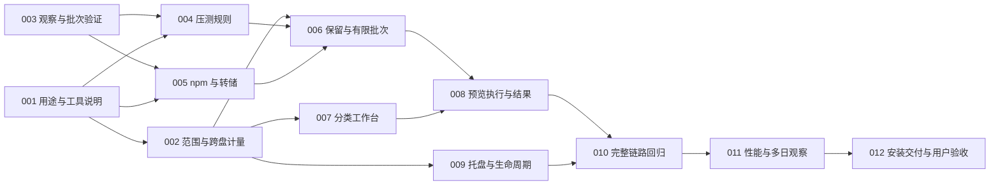

# CClean 首批重做执行计划

## 1. 状态与入口

- 计划 ID：`CCLEAN-20261023-R1`；日期：2026-10-23，Asia/Shanghai。
- 用户已选择 A，按 [D-12](../../../docs/07-product-replanning.md) 确认首批范围，并于本次交接明确授权开始实施。当前状态：执行中；R1-001/002 组件出口已通过，R1-003 已完成获批 USN / 写入租约隔离研究，两者均不足以放行，清单 / 分页 / 恢复组件已有独立证据；R1-007/009 已有实现和组件证据，均为 pending_validation，部分真实桌面检查已进行，系统 / 安装版 / 多 DPI 等仍待验。没有安装或清理现有用户文件。
- 范围基线：[首批重做计划与 A-01～A-10 验收](../../../docs/08-first-release-plan.md)。具体界面：[页面规格](2026-10-23_cclean-first-release/page-spec.md)。机器可读状态：[任务表](2026-10-23_cclean-first-release.tasks.json)。
- 起点：`codex/p0-implementation`，`7d63047fefb10645181c3e69c0479a940bbe50fa`，源码/安装版 0.1.7；旧 28 项任务和验收状态原样保留，作为历史基线，不能跟随新计划创建自动通过。
- MCP：当前未提供 `plan_task/analyze_task/reflect_task/split_tasks/search_nodes`；本地文件是当前任务记录，未创建远端任务或虚构同步成功。工具恢复后按稳定 ID 追加/更新，不清空已有任务。

## 2. 范围与实现约束

首批交付“看懂内容 → 保留指定项 → 核对固定清单 → 执行 → 查看结果”的分类工作台，覆盖 Windows 本机各卷、已知与自定义工具目录及可靠的基础观察。新增规则只验证本次 CClean benchmark；现有专用独占 npm 11.19.0、旧 WSL 转储完成完整业务验收。G 盘构建目录只读解释，实际清理、Agent 增强追踪和版本比较深化后续推进。

| 已核查的现状 | 本次实现选择 |
| --- | --- |
| WPF + WorkspaceViewModel + Core + SQLite 已有完整基础 | 复用现有技术栈与安全执行器，局部抽出共享逻辑；不增加另一套 UI/删除框架，不为工具兼容先造插件平台 |
| 主窗口与概览写死 C 盘；VolumeSpaceReader 和索引查询已有按路径/卷能力 | 从范围映射和 UI 汇总接入多卷；不能只改“C 盘”文案而保持数据源不变 |
| SpaceSurvey 按 FileInfo.Length 逐级累加，GeneratedNames 混合持久数据与产物 | 用途、执行资格、识别证据分开；逻辑量、按身份去重分配和清理估算分别表达 |
| ProjectRegistry 固定工具标签，已有 64 根和重叠约束；发现结果主要在内存 | 维护能力表并允许自定义工具标签；多项目可引用同一已登记数据根。保留物理根去重与预算，优先复用现有索引/配置存储有界摘要 |
| AppPreferences 仅存主题与发现根且有 16 KiB 读取限制 | 小型显示偏好沿用；大量具体保留项放现有 SQLite，并有上限和存储失败反馈，不把 10 万路径塞进偏好 JSON |
| 单批最多 1,000 对象、有效期 5 分钟、审计清单 8 MiB；历史最多返回 3,000 条事件，恢复核查 Take(1000) | 先实测有界候选与端到端处理成本；扫描、确认、审计、结果与恢复范围一同验证，不能只提高候选上限而截断历史或漏掉恢复对象 |
| 关闭窗口目前停止清理并释放 Workspace；App 没有托盘/单实例入口 | 统一应用生命周期；关闭隐藏、明确退出停止，保留一个 Workspace 和一个执行任务。使用 Windows/.NET 现成能力，优先系统托盘组件与命名同步/通知机制 |

benchmark 的 100,002 个文件包括 100,000 个生成样本、一个索引数据库和一个实验标记。盘点父范围实际分配约 20.340 GiB，样本部分约 20.218 GiB；两者都不是已获资格的释放量。首条规则只验证特定运行内的生成 `.bin` 样本，保留 `index.db`、`.cclean-sandbox`、外部报告、生成代码/参数和用户保留项。目录名、标记、文件名规律或当前生成代码单独都不足以证明历史文件来源。

按 [原清理协议](../../../docs/03-cleanup-safety.md) 继续使用具体清单、根/文件身份、活动与未知保护、规则版本、逐项审计和中断不续删。观测到的大小与快照不直接作为删除输入；预览重新核验。同路径替换、新文件和不可确认的活动不能继承旧批准。

## 3. 执行顺序与并行边界

12 项任务编号 `R1-001`～`R1-012`，实际进度以任务表及下列证据为准。页面规格不作为产品实现或使用验收通过的依据。

任务中的 A 编号表示该任务承担的验收部分，并不要求尚未开发的后续页面提前通过。Core/探针任务以自身明确出口推进，完整真实 UI 链路在 010 验证，用户独立操作与整组 A-01～A-10 在 012 汇总判定。



001 与 003 可独立推进；002 与规则研究、007 与 006、009 与界面可按文件所有权并行。WorkspaceViewModel、ProtectionPolicy 和 MainWindow 的共享修改必须顺序集成，不允许各做一套上下文。任何规则未通过验证，不进入可执行选择；不得隐藏失败规则后宣布全部首批目标完成。

### R1-001 用途分类、解释与工具能力

- 状态：passed（组件出口）；依赖：无；验收：A-01、A-09 所负责部分；工作包：P1。实施记录：[sub-001](2026-10-23_cclean-first-release/sub-001-classification.md)；[验证证据](../../../docs/testing/first-release-r1-001.md)。完整 UI 和用户验收仍待后续任务。
- 现有落点：`src/CClean.Core/Monitoring/SpaceSurvey.cs`、`src/CClean.Core/Tools/ToolDefinition.cs`、`src/CClean.Core/Cleanup/ProtectionPolicy.cs`、`src/CClean.Core/Sessions/SessionRegistry.cs`、`tests/CClean.Tests/SpaceSurveyTests.cs`、`docs/research/tool-compatibility.md`。
- 实施：纠正 GeneratedNames 的混合标签，保留其扫描中避免误认项目的作用；为用途、关联证据、影响、重建条件、资格/未知原因建立可复用结果，沿用现有 record 与规则结果，不把 UI 类别直接当白名单。能力表区分安装发现、目录观察、会话元数据与进程证据；同步项目/会话注册校验及工具下拉框，自定义工具只承诺已验证能力。
- 验证：用 `.git/.codex/.cache` 混合根、Claude 会话磁盘、benchmark、G 盘 target 和无规则对象验证说明；没有证据的关联显示未知。分类结果变化不扩大原有执行资格；小型合成分类样例进入现有测试，文案使用页面规格中的三类说明卡。

### R1-002 范围管理、跨盘计量与有界快照

- 状态：passed（组件出口）；依赖：R1-001；验收：A-01、A-08 所负责部分；工作包：P2。实施记录：[sub-002](2026-10-23_cclean-first-release/sub-002-scopes.md)；[验证证据](../../../docs/testing/first-release-r1-002.md)。完整 UI/生命周期与用户验收仍待后续任务。
- 现有落点：`src/CClean.Core/Projects/ProjectRegistry.cs`、`src/CClean.Core/Projects/ProjectCatalog.cs`、`src/CClean.Core/Storage/VolumeSpaceReader.cs`、`src/CClean.Core/Files/WindowsFileMetadata.cs`、`src/CClean.Core/Monitoring/SpaceSurvey.cs`、`src/CClean.Core/Storage/LocalStore.cs`、`src/CClean.App/ViewModels/WorkspaceViewModel.cs`、`src/CClean.App/Views/ProjectSetupView.xaml.cs`。
- 实施：增加改名、调整范围、暂停和移除监测；多项目关联共享根而不重复创建 watcher。移除释放该范围观察器，当前登记汇总排除其旧索引，历史仍带原范围版本保留；异步 Start 完成时重验登记存在和修订一致，防止旧任务重新添回 watcher。旧观察证据不得用于新范围；暂停/移除不自动取消已有显式保护。保存失败回滚 UI 与内存状态。盘点范围与持续观察分别管理，沿用重叠/系统路径/数量预算，超限清楚说明。
- 实施：逐卷容量、逻辑量、去重分配、缺口与关联依据一同返回；共享文件与父子根只在可证明的集合内去重。保存有限的发现/盘点摘要、时间、范围版本与完整度，启动先显示过期快照并允许刷新，不自动恢复清理资格或全盘监测。
- 验证：项目/缓存分盘、父子范围、硬链接、路径迁移、磁盘不可用、无权限、保存失败、重启和更改根；通过现有 ProjectCatalog/ProjectDiscovery/SpaceSurvey/LocalStore 测试补充关键集成样例。不能把缺口填成零或把目录逻辑大小报成释放量。

### R1-003 真实观察与批次可行性验证

- 状态：in_progress（实测出口未通过）；依赖：无；验收：A-03、A-04、A-05、A-07；工作包：P3。[实测证据](../../../docs/testing/2026-10-23-r1-003-feasibility.md)；[具体方案与范围决定](../../../docs/testing/2026-10-23-r1-003-options.md)。已获批并完成 [sub-003 隔离诊断](2026-10-23_cclean-first-release/sub-003-observation-diagnostic.md)，[实测结论](../../../docs/testing/2026-10-23-r1-003-observation-diagnostic.md) 不成立生产归属证明；尚未改变活动保护、清单容量或有效期。2026-10-24 已完成 [写入租约与组件子计划](2026-10-23_cclean-first-release/sub-003-write-lease-components.md) 的隔离研究及组件实现；[租约反例](../../../docs/testing/2026-10-24-r1-003-write-lease.md) 判定 insufficient，[组件测量](../../../docs/testing/2026-10-24-r1-003-components.md) 不代表真实 watcher 或批次出口通过。
- 现有落点：`src/CClean.Core/Monitoring/DirectoryMonitor.cs`、`src/CClean.App/ViewModels/WorkspaceViewModel.cs`、`src/CClean.Core/Cleanup/CleanupExecutor.cs`、`src/CClean.Core/Cleanup/CleanupJournal.cs`、`src/CClean.Core/Cleanup/CleanupRecovery.cs`、`tools/CClean.Poc/Program.cs`、`tests/CClean.Tests/MonitoringTests.cs`、`tests/CClean.Tests/CleanupExecutionTests.cs`。
- 拟新增：`tests/CClean.Tests/CleanupWorkflowTests.cs`（真实调用链集成测试）、`tools/CClean.Poc/CleanupBatchProbe.cs`（有界批次成本探针）。
- 实施：在独立样本上先测 1,000/1,001/10,000/100,000 规模的枚举/身份读取、清单字节、执行吞吐、实际到期位置、审计/DB/WAL、工作集、取消延迟与预期确认次数；首次对原限制的拒绝也作为结果记录。输出可支持规模、瓶颈与协议选型；小内容元数据样本不能冒充读取 20 GiB 的成本。此出口在规则接入和界面定稿前完成，006 依据结果实现并复测。
- 实施（D-13 更新）：真实 watcher 与动态上下文下连续处理至少 3 个批准对象；显式 ObjectReviewV1 按回执与父目录身份复核通知，并复核剩余对象/规则/消费者。符合 B 条件的通知仍来源未确定，不以路径/时间接近冒充唯一归因。危险变化、缺口及故障停止；原始记录保留，严格入口与规则独立验收门槛保持。
- 验证：第二项前注入外部写入、同路径替换、消费者变化、队列溢出或 watcher 故障，后续对象必须保留。根/文件身份变化、过期、审计失败与重启不续删继续通过；未复现风险也要保留覆盖真实链路的证据，不宣称修复不存在的故障。
- 验证：给出有证据的批次方案后才记 passed；如需近 100 次重复确认、超过 5 分钟/8 MiB/原资源预算，该方案未通过。优先保持现有有限清单协议；若必须研究一次固定全集、内部分页，须明确完整集合预先持久化、禁止追加及分页审计/恢复，内部翻页不续期。有效期/执行租约变更要单列技术方案与对抗验证，不能隐式加入首批或宣称已经满足。
- 2026-11-04 续作：[完整 WPF 与 ScanGate 证据](../../../docs/testing/2026-11-04-r1-003-wpf-gate-followup.md)。用户仅批准隔离研究扫描租约；普通扫描时序保持原样。研究十万根首批一万项在有效期内完成、审计/恢复与九万未批准对象保留通过，但研究宿主 269,496,320 B、完整 WPF 空闲 219,189,248 B 均超 200 MiB；资源门槛使十批研究停在首批。R1-003 仍 in_progress，后续依赖不放行。

### R1-004 本次 benchmark 规则与再生成证明

- 状态：pending；依赖：R1-001、R1-003；验收：A-01、A-02、A-04、A-05；工作包：P3。
- 现有落点：`tools/CClean.Poc/Program.cs`、`tools/CClean.Poc/IndexProbe.cs`、`src/CClean.Core/Experiments/ExperimentSandbox.cs`、`src/CClean.Core/Cleanup/RuleCatalog.cs`、`src/CClean.Core/Cleanup/ProtectionPolicy.cs`。
- 拟新增：`src/CClean.Core/Cleanup/BenchmarkRule.cs`、`tests/CClean.Tests/BenchmarkRuleTests.cs`。
- 实施：先只读关联历史运行报告、实验标记、当时生成索引与当前对象，核对生成代码/参数和具体来源证据，输出逐项“依据充分/已变化/缺证据”。报告对应 dirty 工作树时，提交号本身不能冻结当时代码。生成与用户数据无法区分的项保持排除，不补写一份标记便倒推来源已证实。验证同用途合成数据再生成，不承诺恢复原文件身份、时间与实验现场。
- 实施：当前代码的生成契约是 64 KiB 零缓冲写普通文件，前 36,480 个样本长 214,749 B，其余 63,520 个长 214,748 B；核验历史生成依据后才用于检测。需要读取内容时限定本次 fixture，不接触 Agent 会话/凭据；抽样结论只覆盖样本，全部候选的证明与读取成本分别记录。
- 实施：唯一新增规则限定已验证运行的生成样本，保留索引数据库/实验标记/报告/代码和未知文件；接入同一 ProtectionPolicy 和活动约束，规则首次关闭。样例先在独立实验目录验证；大样本按原非系统 NTFS 卷、空间预算与保留余量要求生成。
- 验证：混入用户 `.bin`、报告、源码、链接/ADS、替换样本及标记损坏都不得误入；生成报告可定位到输入、工具和输出样本；实际重建通过。报告分别写“隔离规则验证”和“原有文件资格核验”，不能以前者替代后者。证据不足时报告具体缺口，该任务保持未通过。

### R1-005 npm 与旧转储规则闭环

- 状态：pending；依赖：R1-001、R1-003；验收：A-04、A-05、A-06；工作包：P3。
- 现有落点：`src/CClean.Core/Cleanup/CacheRule.cs`、`src/CClean.Core/Cleanup/CrashDumpRule.cs`、`src/CClean.Core/Cleanup/CleanupConsumers.cs`、`src/CClean.Core/Cleanup/RuleCatalog.cs`、`src/CClean.App/ViewModels/WorkspaceViewModel.cs`、`tests/CClean.Tests/CacheRuleCompatibilityTests.cs`、`tests/CClean.Tests/CrashDumpRuleTests.cs`。
- 实施：真实检测 npm 工具来源与版本，保留专用独占、活动/未知保护，不能用常量冒充检测。对内容与索引验证可处理组合及用户保留子集；无法证明组合有效则明确禁用该组合，不擅自添加未选对象。规则各自生成上下文，不能由一个 npm 活动状态阻止独立合格转储。
- 验证：真实 npm 缓存生成、自然静置、正式观察链路删除及再安装；未知 Node 消费者继续保护，不关闭用户进程凑正向样例。需要独立 Windows 用户环境时先检查可用性，缺失则登记验证缺口。转储保留最新时间全部文件与最近 48 小时；合成时间戳与真实时长证据分开。

### R1-006 保留偏好、有界扫描与批次清单

- 状态：pending；依赖：R1-002、R1-004、R1-005；验收：A-02、A-03、A-05、A-06；工作包：P3、P4。
- 现有落点：`src/CClean.Core/Cleanup/CleanupPlanner.cs`、`src/CClean.Core/Cleanup/CleanupJournal.cs`、`src/CClean.Core/Cleanup/CleanupRecovery.cs`、`src/CClean.Core/Storage/LocalStore.cs`、`src/CClean.App/ViewModels/AppPreferences.cs`、`tests/CClean.Tests/CleanupPlanTests.cs`。
- 拟新增：`src/CClean.Core/Cleanup/CleanupCandidateScanner.cs`（仅在现有枚举逻辑无法直接复用时）。
- 实施：把按规则的候选枚举从页面移到共享入口；按预算流式生成有限批次，排除原因样本和待扫描位置有上限；新文件不加入旧批准。业务保留逻辑放 Core 并通过现有测试工程验证，小型显示偏好仍由 AppPreferences 负责。按范围/规则版本保存类别偏好和具体保留，路径或身份变化重判；保留是默认排除，新增规则不会被旧偏好自动启用。多根间不重复统计或饿死后续规则。
- 实施：按 003 的选型实现，并用 1,000/1,001/100,002 规模复测清单字节、预览/执行耗时、内存、审计增长、确认次数与跨批保留。5 分钟有效期、8 MiB 清单及原资源预算保持；调整每批数量必须有对应实测和边界测试，不能只删 Take/Truncated 检查。历史查询与恢复核查同步支持有界分页/完整度，不能默默只显示前 3,000 条或仅核查前 1,000 个对象。
- 验证：Core/探针从大目录直接形成可执行本批，返回已检查/本批/剩余未知；在隔离大样本实际多批执行中记录成本和跨批保留一致性。006 的通过依据上述组件证据，不依赖尚未开发的 UI。真实 UI 无需重新查找目录/逐页重选，以及用户对确认负担的验收由 008/010/012 完成；A-03 整体保持待验，不能以组件通过替代。

### R1-007 分类工作台与范围管理页面

- 状态：pending_validation（实现与组件证据已有，真实 UI 待验）；依赖：R1-001、R1-002；验收：A-01、A-08、A-09；工作包：P1、P2。[实施证据](../../../docs/testing/first-release-r1-007.md)。
- 现有落点：`src/CClean.App/MainWindow.xaml`、`src/CClean.App/MainWindow.xaml.cs`、`src/CClean.App/Views/OverviewView.xaml`、`src/CClean.App/Views/OverviewView.xaml.cs`、`src/CClean.App/Views/ProjectWorkbenchView.xaml.cs`、`src/CClean.App/Views/ProjectSetupView.xaml`、`src/CClean.App/ViewModels/WorkspaceViewModel.cs`。
- 实施：按页面规格落地“空间与清理”启动页、分类/列表/说明联动、工具/项目/磁盘筛选和持续可见的观察状态。开发活动与项目/版本复用已有页面能力，不接入虚假的进程证实；设置和清理历史从对应上下文进入，系统清理按钮明确外部工具名称。
- 实施：后台扫描有取消、进度与范围版本，旧请求结果不能覆盖新范围；清楚区分未扫描、无内容、未支持、活动中、不完整和错误。保存失败原位提示，配置不可用不伪装成首次空白状态；不为上述目标强制引入新的 MVVM 框架。
- 验证：页面规格三张说明卡、快速切换范围/切页/重扫、无权限/空状态；键盘焦点、虚拟化/分页、长路径、中文、浅深主题和实际 125%/150%/200% DPI。查看报告或范围详情返回后保留选择与位置。

### R1-008 选择、预览、执行与结果页面

- 状态：pending；依赖：R1-006、R1-007；验收：A-02、A-03、A-06、A-07、A-09；工作包：P4。
- 现有落点：`src/CClean.App/Views/CleanupPreviewView.xaml`、`src/CClean.App/Views/CleanupPreviewView.xaml.cs`、`src/CClean.App/Views/CleanupHistoryView.xaml`、`src/CClean.App/Views/CleanupHistoryView.xaml.cs`、`src/CClean.App/Views/FilesView.xaml.cs`、`src/CClean.App/ViewModels/WorkspaceViewModel.cs`。
- 实施：所有入口使用同一选择/预览服务；类别、具体项、筛选和跨页保留语义一致。预览列出本批范围、各类影响、合计与到期时间；确认后仅执行具体清单，不能将查阅行当选择，也不能将“全选本页”当“全部结果”。
- 实施：执行任务由 Workspace 持有，切页/重复点击不创建第二次执行；给现有 Executor 加轻量进度回调或 IProgress，停止、失效、失败和部分完成有准确状态。结果按卷分列成功/跳过/失败/未执行、对象分配和系统可用量变化；历史能查完整清单与事件，不确定结果保持未知。后续批次重新预览确认，重启不重放。
- 验证：混合规则、保留子集、过期、新增/替换、文件消失/占用、取消、审计失败、并发占盘和测量失败，列表与审计一一对应；暂停增强或关闭页面不得扩大删除授权。
- 验证：真实 UI 能从大目录自动形成下一份待确认预览，保留项跨批继续生效，无需反复查找目录和逐页重选；记录完成目标的批数、确认次数、操作耗时，在 010 复验、012 由用户独立检验实际负担。需大量重复确认的结果不能仅凭 Core 通过标为 A-03 通过。

### R1-009 托盘、单实例与观察生命周期

- 状态：pending_validation（已有实现与组件证据，真实系统/安装版待验）；依赖：R1-002；验收：A-07、A-08、A-09；工作包：P2。[实施证据](../../../docs/testing/first-release-r1-009.md)。
- 现有落点：`src/CClean.App/App.xaml`、`src/CClean.App/App.xaml.cs`、`src/CClean.App/MainWindow.xaml.cs`、`src/CClean.App/ViewModels/WorkspaceViewModel.cs`、`src/CClean.App/CClean.App.csproj`。
- 实施：系统托盘提供恢复、观察状态、暂停/恢复和明确退出；窗口关闭仅隐藏，明确退出请求停止后续清理并等待当前项安全结束再释放观察器/审计。第二次启动唤醒同一实例，不重复创建 watcher/执行器；无需联网消息通道，不默认开机启动。
- 验证：观察中/扫描中/清理中关窗、托盘恢复、重复启动、明确退出、系统会话结束和异常进程退出。停止状态不能卡成“已退出但仍删除”；强制终止后的结果由恢复核查处理，不自动续删；重启标出空窗。

### R1-010 规则与界面完整链路回归

- 状态：pending；依赖：R1-008、R1-009；验收：A-01～A-09；工作包：P4、P5。
- 现有落点：`tests/CClean.Tests/CleanupExecutionTests.cs`、`tests/CClean.Tests/CleanupRecoveryTests.cs`、`tests/CClean.Tests/DeletionSafetyTests.cs`、`tools/CClean.UiProbe/Program.cs`、`tools/CClean.Poc/CacheProbe.cs`、`docs/testing/cleanup-acceptance.md`。
- 实施：在同一待交付构建上串起发现/说明/保留/预览/真实执行/结果/重建；覆盖三规则独立与混合、跨盘缺口、真实 watcher、预算与中断。对新增偏好、范围摘要及配置版本执行旧 0.1.7 升级迁移；迁移失败保留旧文件并停止危险操作，未知高版本拒绝覆盖。
- 验证：选中的必测用例数量大于 0；现有对抗测试与新集成场景通过。安装版用户体验最终在 012 复验，不用 UiProbe 或单测替代人实际使用；每个未通过项有操作/预期/实际/修复版本/复验记录，历史 pending_validation 不自动关闭。

### R1-011 性能、空间预算与多日稳定性

- 状态：pending；依赖：R1-010；验收：A-03、A-10；工作包：P5。
- 现有落点：`tools/Measure-AppIdle.ps1`、`tools/Measure-AppStability.ps1`、`tools/CClean.UiProbe/LatencyProbe.cs`、`tools/CClean.Poc/IndexProbe.cs`、`src/CClean.Core/Storage/RuntimeBudget.cs`、`docs/testing/release-acceptance.md`。
- 实施：按原采样协议复测 10 万文件/20 GiB 的首扫（冷/热条件分别记录）、10 分钟空闲 CPU/工作集、交互延迟、预览取消、审计/索引预算与实际多批成本；只针对瓶颈调整，保留身份和持久审计校验。
- 验证：CPU ≤ 1%、工作集 ≤ 250 MB（250,000,000 字节）、首扫 ≤ 60 秒、UI P95 ≤ 2 秒、DB/WAL/SHM ≤ 300 MiB、日志 ≤ 50 MiB；扫描取消后目标 2 秒内回到可操作状态，实测失败就记录失败。内存旧失败不能四舍五入为通过。
- 验证：新版连续 72 小时（259200 秒）、30 秒采样，记录正常开发负载、暂停/托盘状态、卷不可用与观察缺口；超过 90 秒采样空窗需解释并重新形成有效连续证据。脚本退出 0 只代表采样结束，当前 MultiDayAcceptance=not_assessed 不能改称通过；单独评估 CPU/工作集/私有内存、预算、异常与趋势，不能把 72 小时无崩溃写成绝无泄漏。现有 DataBytes 仅统计顶层文件；新增子目录时同步补足测量范围。长时平均 CPU 不替代 600 秒空闲验收，活动峰值与空闲门槛分开评估。

### R1-012 内部安装交付与用户独立验收

- 状态：pending；依赖：R1-011；验收：A-01～A-10；工作包：P5。
- 现有落点：`tools/Build-InternalPackage.ps1`、`packaging/CClean.iss`、`src/CClean.App/CClean.App.csproj`、`README.md`、`CHANGELOG.md`、`docs/user-guide.md`、`docs/audit/implemented-features.md`、`docs/05-delivery-plan.md`、`docs/testing/personal-acceptance.md`。
- 实施：从可追溯干净提交构建内部包，记录版本/提交/哈希，验证全新安装与 0.1.7 升级的配置/历史/偏好迁移。安装构建须对应功能/资源证据，影响相关行为的后续变更必须复验相应门槛；保持未知规则默认关闭。按实际能力更新首页功能摘要、用户说明、随包审计及总账。
- 验证：用户在安装版独立完成用途判断、保留、预览核对和可追溯结果查看；不依赖开发者口头解释。记录大样本确认次数、理解困难、误选和任务完成情况，有困惑回到对应任务修正。正式 npm UI 和 benchmark 原文件资格缺口必须如实列出，不能用隔离演示代替全部目标。
- 完成出口：A-01～A-10 与相关原安全门槛均有同版证据才通过；用户验收待进行时保持 pending_validation。仅按真实证据更新旧 DEV-013/017/018/019/020/023～028 的对应部分，旧 ETW/USN 延后状态保留；不公开发行，不自动执行真实用户文件清理。

## 4. 检查与证据组织

以下为实施命令；已运行结果见各任务证据与第 6 节，规划时未运行产品测试。新增测试沿用既有 xUnit 工程和 `MvpP0`，需要全链路分组时使用已有计划约定的 `CleanupWorkflow`；先列用例，不能 0 用例也记通过。

```powershell
dotnet build CClean.slnx -c Release --nologo
dotnet test tests/CClean.Tests -c Release --list-tests
dotnet test tests/CClean.Tests -c Release --no-build --filter Category=MvpP0
dotnet test tests/CClean.Tests -c Release --no-build --filter Category=CleanupWorkflow
```

性能/稳定性命令在执行时带入实际 PID、数据根、未存在的 artifacts 输出路径和构建提交，不预填机器进程号；`Measure-AppStability.ps1` 使用 `-Seconds 259200 -IntervalSeconds 30`。测量输出与应用数据库分开，按既有磁盘容量守卫选择非系统测试范围；不为验证填满 C 盘。

证据目录使用 `artifacts/first-release-<实际运行标识>/`，仓库验收文档记录摘要和可定位证据。界面样例、隔离生成数据、原目录资格核验和真实用户操作分别标记；每个 task 的 evidence 初始为空，未运行不写 passed。

## 5. 风险、失败处理和旧计划关系

| 风险 / 已有教训 | 对应处理 |
| --- | --- |
| benchmark 没有逐文件来源证明、历史运行代码可能与 HEAD 不同 | 004 先给证据清单，区分可证实样本和未知项；不追认整个根，不削弱 .db/源码保护 |
| own-delete 与外部写入混淆 | 003 先复现真实 watcher；不能用时间窗/路径豁免掩盖外部变化 |
| npm 任意子集破坏内容/索引关系 | 005 组合验证与保留影响前置；不偷偷补入未选择对象 |
| 100,002 文件被拆成大量重复人工操作 | 006/011 实测清单字节、吞吐、确认次数与保留；A-03 未通过时继续改进，不按“可分批”宣称可用 |
| 生命周期变化引入重复观察或停止失效 | 009/010 覆盖关窗、托盘、二次启动、退出、中断与单执行任务 |
| 资料很全、实际还是看不懂 | 012 要用户独立操作证据；额外口头解释视为待改进项 |
| 旧通过记录掩盖新版资源/稳定性缺口 | 011/012 绑定同一交付版本，旧 200.73 MiB 失败保留至新版实测；安装包或相关实现变化按影响重验 |

本地 `.codex/lessons/` 不存在，全球经验搜索工具不可用；以上来自本项目调研、源码和旧 sub-028，不能宣称已查询全局知识库。UI/UX 检索匹配到 WPF 异步、防重入和后台耗时操作，采纳行为目标，未据此新增 CommunityToolkit 依赖。

新计划接替当前规划入口，旧主计划及 28 项任务保存为历史与未结验收依据；没有改写旧任务完成状态。后续开发采用本计划范围，旧 sub-028 中与新范围不一致的批次/界面细节以本计划的验证门槛为准。任务状态只有实际实施/验收才能推进。

## 6. 本轮记录

2026-10-23：用户确认首批范围（D-12）；形成页面规格、12 项任务、依赖图、文件落点与验收步骤；更新当前计划入口。本次仅规划文件发生变化，没有开始业务开发。页面设计稿的形成不代表真实界面或用户验收通过。

2026-10-23 实施接手：核实分支、HEAD 与交接一致；保留全部未提交规划文件。既有 `Category=MvpP0` 93/93 通过；开始 R1-001、R1-003。MCP 不可用，仅记录本地状态，旧任务未更改。

2026-10-23 R1-001：用途说明、八款工具/自定义能力与注册链路完成；全 solution Release 0 警告/错误，当前 MvpP0 123/123 通过。组件出口 passed，完整 UI/安装版用户验收不据此关闭。开始 R1-002；R1-003 已复现自身删除造成活动失效，保持未通过并继续测量，不按路径/时间豁免事件。
2026-10-23 R1-002 收口：范围编辑/移除、共享根、跨卷计量、有界过期摘要与会话原根保护完成组件验证；最终 solution Release 0 警告/错误，MvpP0 151/151，WPF Dispatcher + 真实 watcher + SQLite 隔离探针 10/10。补齐保存期间另一根换路径的历史污染保护、真实 ACL 缺口、C/D 分卷及遗留会话结束入口。R1-002 组件出口 passed，未替代完整 UI/DPI/用户验收；旧任务表 SHA-256 保持原值。

2026-10-23 R1-003 方案：四规模实测与失败证据已归档，当前首项后自身活动失效、100次确认和完整研究资源成本均未满足出口。离线紧凑 DTO 1,000 项 229,906 B 仅证明候选编码可减重，不是新容量验收。是否前置原延期 USN/扩展通知的隔离诊断已向用户提出唯一范围取舍，未批准前不纳入产品；5 分钟、8 MiB、未知保护及旧 deferred 状态保持。R1-004/005/006 依赖尚未满足，R1-007/009 可独立继续。未安装、commit/push 或删除现有用户文件；仅本地任务记录，MCP 不可用。

2026-10-23 获批诊断收口：用户明确允许 C 窄化隔离诊断，8 组动作/26 阶段完成。长寿命父时间和文件同长度重复修改均有 Changed，但新 USN 区间 0 条；不能直接放行。双身份桥、本机只读已有 journal 和取消得到证据，原执行器仍删 1 项后 NeedsPreview。R1-003 保持未通过，004/005/006 不越依赖；按现有依赖启动 sub-007 分类工作台与 sub-009 生命周期。旧任务哈希未变，仅本地同步。

2026-10-23 R1-009 实现收口：原生托盘、单实例与安全退出接线已有实现；20 项完整主窗组件断言、启动/写入前保存屏障及 152 项回归通过，转 pending_validation。生产 App 双启动/最终锁释放、实际托盘菜单/系统会话/异常退出与安装版未验；桌面锁定，停止实际 UI 输入并留下中断记录。R1-007 偏好错误处理正在补修，暂不关闭；R1-003 更严格写入租约仅提窄隔离方案，未获新决定前不研究或改生产协议。

2026-10-23 R1-007 实现收口：补修偏好损坏/超限/读取失败被吞为默认的缺陷，Workspace 创建前加载、错误页保留、禁止主题覆盖坏文件。最终 solution Release 0 warning / 0 error，152 项相关回归通过；偏好前置后重新验证 20 项主窗断言，另有 14 项偏好检查完整通过。007/009 均 pending_validation，实际 UI/DPI/托盘/会话和安装版缺项保留；不据此越过 003/004/005/006。旧任务 SHA-256 未变，无远端同步。
2026-10-24 获批写入租约与组件优化收口：仅在新建 fixture 研究两种访问 / 共享组合，共 14 组，均有未覆盖父属性 / 子树反例并判 insufficient；8 次受控取消均释放，普通读取受阻情况已记录。没有改变生产共享、活动保护或现有用户目录。版本化紧凑 manifest、完整历史 / 恢复分页与 UI 读取 drain 已实现；全方案最终 Release 零警告 / 错误，相关回归 158 / 158。2,505 项清单减重 77.72%，固定上下文隔离 1,000 项约 144.89 项 / 秒、下一批取消约 11 ms；10 万项仍推算 100 次确认，实际 UI 确认 0，不能通过批次出口。

2026-10-24 实际桌面补证：解锁后复验工作台中文长路径 / 盘点 / 返回 / 深色主题 / 明确退出。历史页首轮真实 600 px 矮窗发现表格塌陷，保留失败并修复为整页滚动 + 有限表格视口；18 项历史组件通过，实际矮窗翻过 200 / 200 / 5 尾页，切换原始审计 / 恢复核查及明确退出通过所测回归。安装版、多 DPI、完整键盘、系统托盘 / 会话及用户独立闭环仍未通过。007 / 009 保持 pending_validation，006 / 008 只记录组件前置工作，003 / 004 / 005 / 006 原依赖未放行。旧任务和 200.73 MiB 失败保留，无安装、commit / push、现有用户文件清理或远端 MCP 同步。

## 2026-10-25 D-13 执行更新

用户选择 B，批准对象级契约实施与隔离验证，详见 `docs/03-cleanup-safety.md` 第 9 节及 `docs/07-product-replanning.md` D-13。旧归因/租约反例保持原结论；本轮不再用通知来源唯一证明作为新契约出口。R1-003 仍执行中，新增子记录 `sub-003-object-contract.md`。规则、批量容量与实际操作负担各自验收，后续依赖不提前通过。

2026-10-25 本轮实施结果：2026-10-25 D-13/B 对象级契约实现与隔离验证完成：真实 watcher 连续 3/100/1000 项通过；最终1000项64.221秒，原始通知/来源不确定/逐项复核保留；父元数据混合风险案例和危险停止矩阵通过。Release零警告错误，190回归、13 Workspace保护接线通过。中间到期、解码与观察不可靠失败均保留并修复复测。新契约只供隔离验证，普通入口仍严格；真实Node消费者阻止npm候选，正向Workspace清理未验。跨批仍受30分钟近期活动保护，1001/10000只验证拒绝截断，100000确认成本未通过，R1-003整体不放行。 证据：[`对象级契约报告`](../../../docs/testing/2026-10-25-r1-003-object-contract.md)。旧任务、资源失败与用户文件边界保留。

## 2026-10-25 跨批证据衔接更新

2026-10-25 跨批证据衔接组件完成：同一执行器完整成功后可生成新的待确认清单；真实 watcher 的 3批×1项、3批×100项通过，原始活动与未选文件保留。Release零警告错误，210/210回归（新增20项跨批检查）、13项Workspace保护检查通过。前批5分钟证据期限、每批明确确认、有界回执与失败停止保留。仅核心API/隔离验证，未接入Workspace/UI连续操作；普通入口仍严格。本机Node消费者仍阻止正向清理。100000项至少100次确认、实际规则/容量/资源及安装版验收未完成；R1-003仍in_progress，004/005/006依赖不放行。 证据：`docs/testing/2026-10-25-r1-003-batch-continuity.md`。此前跨批阻断记录保留为历史，普通 Preview 仍遵守近期活动保护。

## 2026-10-25 Workspace 与预览收尾更新

2026-10-25 继续推进：Workspace 跨批预览已接入同进程任务/取消/互斥/退出管理，仅供隔离验证；修复页面预览切页、取消、到期、转储枚举重入、主窗退出等待和空间测量未知反馈。首次drain忙循环失败已保留并修复。Release零警告错误，210/210回归、19预览Workspace、13真实消费者保护、20主窗检查及2退出屏障场景通过。桌面锁屏，实际UI/多DPI未验。编码研究10000项约3.39MB、100000项被8MiB拒绝；新复核时机或首批规模需用户选择，R1-003仍in_progress，后续依赖不放行。 证据：`docs/testing/2026-10-25-r1-workspace-preview-lifecycle.md`。容量取舍：`docs/testing/2026-10-25-r1-003-capacity-decision.md`；未改变D-13或缩减首批目标。

末次补修：确认后的准备期也记住停止请求，不启动后续删除；最终预览/Workspace探针21项通过（此前19项保留为中间证据），Release重建零警告/错误。

## 2026-10-25 分段研究结果

2026-10-25 获批固定清单分段复核研究完成，但容量方案不足：真实 watcher 1000/1001 项约23秒完成，10000项在5分钟到期时仅完成1781项，等待扫描门时停止；8219项及未选择文件保留。Release零警告错误，233项非容量回归、3项进程中断恢复、13消费者保护和21预览生命周期检查通过；容量测试2通过1失败，失败证据保留。普通入口仍1000项且不启用研究契约。R1-003保持in_progress，004/005/006/008依赖不放行；实际规则/资源/安装UI/72小时仍待验。

证据：`docs/testing/2026-10-25-r1-003-segment-research.md`。下一步先做分阶段耗时诊断；不把研究失败转换为普通入口授权或首批范围缩减。

## 2026-10-25 最新执行记录

2026-10-25 吞吐与工作台优化完成本轮验证：Release 零警告错误，235 项非容量回归、25 项研究保护检查、3 项进程恢复、24 项主窗及最新 13 项消费者保护通过。小根 1000/1001/10000 项通过，一万项执行 173.928 秒；十万文件根批准一万项仍失败，到期完成 6549 项，扫描门等待 197.577 秒，测试宿主峰值 250.5 MiB。3451 个未完成批准对象和全部 90000 个未批准对象保留。R1-003 仍 in_progress，后续依赖未放行；007/009 待完整真实验收，资源/72 小时/安装升级及用户独立验收未关闭。旧失败与旧任务保留，无安装提交或既有用户文件清理。

详细实测及后续顺序见 [吞吐与工作台复验](../../../docs/testing/2026-10-25-r1-003-throughput.md)。

## 2026-10-28 预览安装包与吞吐推进

2026-10-28 产出 0.2.0-preview.1 可追溯自包含安装包；保留未提交工作。235 回归、36 定向检查、24 主窗/21 预览/13 消费者保护/14 偏好检查通过，Release 零警告错误。十万文件根一万项完整清单 198.126 秒完成，90000 未批准文件保留；测试宿主峰值约 253 MiB，资源与实际多批未通过。普通入口严格且最多1000项，研究未启用。R1-003仍in_progress，规则/保留/统一跨批依赖未放行；完整UI/多DPI、72小时、安装升级与用户独立验收仍待办。发布目录隔离启动/双启动通过；桌面工具native pipe缺失，本轮未做实际人机交互验收，未安装到现有用户环境。

证据：[本轮报告](../../../docs/testing/2026-10-28-preview-package.md)。预览交付与正式 R1-012 验收分别记录，不重置旧状态。

## 2026-11-04 最新执行记录

2026-11-04 按用户要求继续原计划开发，未再次打包；上次预览包标记user_reported_invalid、根因未知。完成不可变通知历史共享、游标后缀定位、完整句柄校验后的元数据值复用和契约隔离的研究跨批。Release零警告/错误，266项非容量回归、85项重合定向检查、3项真实子进程恢复、24主窗/21预览/13消费者/18历史分页检查通过。最新十万根首批到期7499项、宿主峰值261173248B（约249.1MiB）、扫描门等待112.43秒；2501个剩余批准项及90000未批准项保留，未进入第二批，容量和资源未通过。R1-003仍in_progress，004/005/006/008依赖不放行；完整产品资源、真实UI/多DPI、72小时、安装升级与用户独立验收未关闭。旧包与旧28项任务表哈希未变，未安装、提交、推送或清理既有用户文件。

本轮报告：[`通知历史与研究跨批`](../../../docs/testing/2026-11-04-r1-003-memory-continuity.md)；后续资源工作继续保留于 sub-014-memory-continuity.md。安装包反馈仅撤回有效性交付状态，不倒退已证实的独立源码组件，也不删除旧失败或原有未提交工作。
