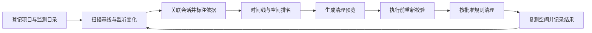

# CClean

面向 Agent 开发的 Windows 磁盘写入可视化与安全清理工具。

按 **项目 → Agent 会话 → 文件变化** 展示类似 Git 分支的时间线，帮助开发者理解 C 盘空间增长的来源，并通过可预览、可审计的清理流程释放空间。

> 当前阶段：0.1.6 个人使用版。项目工作台支持手动发现更多项目、项目概览、开发时间线、文件与空间、清理位置、会话和只读版本比较；记住主题与上次项目发现范围。发现不会自动登记监测，也不是自动找齐 C 盘所有项目。生产清理仍限于已验证的专用独占 npm 缓存和旧 WSL 崩溃转储，旧版本文件夹不会因内容相同而获准删除。功能、性能与尚未完成的验收分别见 [已实现功能审计](docs/audit/implemented-features.md)、[使用说明](docs/user-guide.md) 和 [发行验收](docs/testing/release-acceptance.md)。

## 已确认的产品方向

- Windows 11 本地桌面应用，首版目标平台为 x64。
- 优先覆盖 Codex、Claude Code、[ZCode](https://zcode.z.ai/cn)。适配能力按版本验证，通用目录登记与手动会话始终可用。
- 可视化按项目、会话和文件写入组织，可按时间回看；不是实际 Git 分支，也不提供文件版本回滚。
- 清理必须先预览，保护活跃项目与来源未知文件；一键执行仅覆盖用户启用并确认的缓存规则。
- 当前推荐技术栈为 C# / .NET 10 LTS、WPF、SQLite；由监测与清理 PoC 验证后定版。
- 以监测、预警和受控清理改善 C 盘可用性；不承诺阻止所有进程把磁盘写满。

## 当前使用方式

1. 打开项目工作台，查看已登记项目和支持的工具会话工作目录；通过“发现更多项目”选择父目录，分批只读发现代码项目。系统、已识别的安装/依赖目录与链接范围会被排除。
2. 点击项目查看概览及各页。代码根与监测范围分开表示：只登记了 `src` 的仓库显示“部分子目录已监测”，需打开对应子项目查看历史。
3. 在“版本比较”主动选择另一个互不包含的目录，按相对路径检查独有、差异、相同与未确认文件。每侧最多盘点 10,000 项，内容读取合计最多 512 MiB，单次时间预算 30 秒；缺口和不确定结果保持保护。
4. 在“清理位置”逐位置复核真实候选，再进入清单确认。目录占用、现存文件增长与候选空间是不同口径，不能混为可释放空间。

监测与盘点读取文件元数据；用户启动的版本比较会读取符合条件的普通文件内容。没有内置上传，具体本地数据范围见 [隐私说明](docs/privacy.md)。

## 文档导航

| 文档 | 内容 |
| --- | --- |
| [产品需求](docs/01-product-requirements.md) | 用户场景、MVP、范围、指标与需求编号 |
| [技术架构](docs/02-architecture.md) | 技术选型、监测与归因、数据模型、权限及容量预算 |
| [安全清理协议](docs/03-cleanup-safety.md) | 清理分级、保护规则、预览与执行、竞态及恢复 |
| [界面与交互](docs/04-ux-flows.md) | 页面结构、分支时间线、清理操作及异常状态 |
| [开发执行计划](docs/05-delivery-plan.md) | 阶段依赖、开发步骤、产出、验收、测试与发布 |
| [决策与参考](docs/06-decisions-and-sources.md) | 已确认事项、默认假设、待验证事项与资料来源 |

## 产品闭环

## 实施顺序

1. 验证 Windows 监测、空间计量、文件删除身份校验和至少一个外部缓存规则。
2. 建立只读磁盘总览、目录基线扫描与有上限的本地存储。
3. 增加项目、会话、归因证据和分支时间线。
4. 完成规则分类、清理预览和保护机制，先验证 dry-run。
5. 开通清理执行，完成竞态、崩溃、低空间与真实工具验收。
6. 按验证结果加入 ETW / USN 增强，并完成 Windows 打包发布。

具体任务与完成标准见 [开发执行计划](docs/05-delivery-plan.md)。开发阶段在这些文档中更新状态；源码可构建，内部安装包在本地 artifacts 生成，不提交二进制。

## 仓库约定

- 文档与新增文本采用 UTF-8、LF；已有带 BOM 的文件必须保留 BOM。
- 不提交本机扫描结果、真实路径清单、Agent 会话、凭据、数据库或诊断转储。
- 示例全部使用合成数据。诊断导出必须先在本地脱敏。
- 当前采用私有仓库管理；许可证与是否开源在公开发布前另行决定。

0.1.4：新增 Codex / Claude Code 项目会话自动发现与独立页面。完整能力、保护边界和未完成项见 [已实现功能审计](docs/audit/implemented-features.md)。

0.1.5：点击项目卡片进入开发工作台；清理标记必须逐位置复核，源码/旧版本/普通构建目录不会自动获准删除。

0.1.6：完善项目发现与归组、集中项目概览、只读版本比较和设置记忆；通过复用扫描缓冲和未变化快照、减少重复索引副本及数据库内汇总降低内存开销。长期稳定性与大样本表现以实际验收记录为准。
