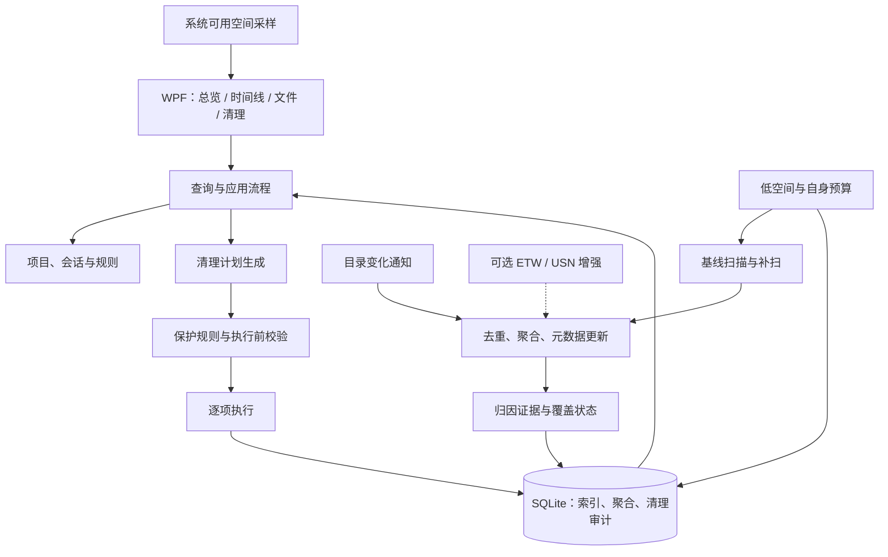

# 技术架构

版本：0.1 · 状态：推荐方案，Windows PoC 后定版。资料来源见 [决策与参考](06-decisions-and-sources.md)。

## 1. 技术选型

| 方案 | 适合之处 | 代价与边界 | 决定 |
| --- | --- | --- | --- |
| C# / .NET 10 LTS + WPF + SQLite | Windows 文件 API、桌面 UI 和后台任务可使用同一语言；无需常驻 Web 服务 | 时间线需要做聚合、绘制与命中测试；只支持 Windows | 推荐首版 |
| Tauri 2 + React + Rust + SQLite | Web 图交互生态丰富，利于未来跨平台 | 引入前端、Rust、IPC 与系统权限边界，Windows 监测仍需单独实现 | 有明确跨平台需求时再评估 |
| Electron + TypeScript | 团队若已有 Web 技术积累，上手方便 | 携带浏览器运行时；底层采集通常需要原生桥接 | 当前没有既有代码优势，不优先 |
| 纯命令行/网页 | 适合验证扫描和规则 | 不完整满足持续监测与桌面操作需求 | 仅作为 PoC 载体 |

采用 .NET 10 LTS 的依据是 Microsoft 当前支持策略，而非本机已经具备 SDK。开发环境安装、依赖版本与运行时分发在 M1 冻结。资源消耗优劣必须实际测量，不能仅凭框架名称保证。

建议初始依赖仅使用 .NET/WPF 和 `Microsoft.Data.Sqlite`。基础 UI 使用 WPF 原生控件、虚拟化列表和自绘聚合时间线；只有测量证明需要时才增加 MVVM/图形库。ETW 库在独立 PoC 后决定。

## 2. 运行结构

普通模式采用一个桌面进程，后台异步执行扫描与存储，不做微服务、常驻管理员服务或默认开机自启。关闭窗口是否缩到托盘由用户选择；完全退出时停止采集并结束/中断本地会话。

后续 ETW/USN 若需要提权，使用按需启动的受限采集辅助进程。它只输出约定的采集数据，默认不持有清理能力；IPC 限制为当前用户，输入设长度、类型和资源上限。拒绝提权后普通模式继续工作。

建议 M1 工程结构：`CClean.App`（WPF）、`CClean.Core`（扫描/规则/本地存储）、`CClean.Tests`（关键集成与安全用例）。无需提前创建每个概念对应的独立项目。只有启用增强采集后才增加辅助进程工程。

## 3. 监测层级与能力差异

| 来源 | 可提供 | 不能可靠提供 | 首版安排 |
| --- | --- | --- | --- |
| 系统容量 API | C 盘总量、当前用户可用量、卷剩余量 | 空间由哪个任务占用 | P0，默认 5 秒采样，清理前后额外采样 |
| 元数据枚举 | 当前对象、逻辑大小、部分分配信息、文件身份 | 历史写入过程、写入进程 | P0，首次扫描与状态校准 |
| FileSystemWatcher | 指定目录中的变化通知 | 无损审计、准确写入次数/字节、PID | P0，作为重新查询状态的提示 |
| USN Journal | NTFS 文件身份和变更原因，可辅助定位补扫 | PID、内容、完整写入流量和文件回滚 | P1，先只读验证权限与游标失效 |
| ETW File I/O | 可关联的线程/进程、文件对象与请求字节 | 所有路径下的完美归因、实际新增占用 | P1，独立 PoC 后增强 |

依据 [S1]–[S8]：目录通知可能重复、延迟或丢失；USN 会合并记录且历史有限；ETW 也需监测丢事件。任何模式都必须携带覆盖范围、采样时间和完整性状态。

## 4. 扫描与增量流程

1. 用户登记项目和 C 盘目录；规范化路径、去除重复监测根，阻止默认跟随 reparse point。非 C 盘项目仅登记上下文，是否扫描其他卷需用户另选。
2. 尽可能先启动有界通知队列，再进行带 generation 标记的初始枚举。扫描期间缓存变化提示，扫描后重查受影响对象，处理基线与监听之间的窗口。
3. 按卷和 File ID 合并同一文件，路径是可变化的别名。重命名/移动不当成两份独立占用；无法配对时标为待校准。
4. 对变化提示按文件或目录去抖，初始窗口建议 300–500 ms；读取新元数据，计算同一有效基线上的差值。
5. 队列初始上限建议 20,000 条提示。溢出时将监测根标记为 dirty，归并到目录重扫，不扩大成无限内存队列。
6. 权限失败、事件溢出、重启、磁盘移除、目录移动导致覆盖变化时，记录缺口并安排有预算的重新枚举。
7. 默认每 15 分钟轮转校准已登记根目录；按用户活动、规模和低空间状态调节，不默认重扫全盘。重新配置监测根必须建立新基线。
8. 静默期补扫完成后恢复当前状态一致，但不能补造缺失期间的精确时间线。缺口标识在历史中保留。

首次使用提供独立的“发现候选目录”只读任务：用户确认个人工具数据目录范围后，分批枚举并展示已覆盖部分的目录占用候选。初始单批预算建议 30 秒或 100,000 个对象，达到预算可继续，不默认扫描整个 C 盘；访问失败、不跟随的链接和未完成范围明确展示。用户确认候选后才纳入持续监测，发现结果永远不自动变成清理白名单。

短命文件可能在两次查询之间创建并删除；只能记录已观察到的通知，不能推算其大小。网络卷、虚拟文件系统与容器内部不纳入首版一致性承诺。

## 5. 项目与会话归因

归因等级是证据类别，不用未经校准的“置信度百分比”。

| 类别 | 需要的依据 | 展示方式 |
| --- | --- | --- |
| 进程证实 | 事件明确关联进程实例，且进程与会话绑定经过验证 | 展示进程实例、事件来源与会话绑定方式 |
| 上下文关联 | 已登记路径、会话时间范围、用户绑定，缺少直接进程证据 | “会话期间观察到”，不写“确定由此 Agent 写入” |
| 共享 | 多项目/多会话可能消费同一对象，或规则确认是全局缓存 | 展示多个关联，不分摊成虚构的精确独占量 |
| 未知 | 证据不足、采集缺口、工具版本未支持 | 保留未知，不进入一键清理 |

维护独立的 `ProcessInstance = PID + StartTime`，避免 PID 复用；父子进程关联也带起止时间。进程树可辅助识别 `node`、`python`、构建器等子进程，但独立守护进程和多个会话共用进程不能靠父 PID 硬分配。

活动保护综合用户显式标记、会话状态、已验证进程实例、近期变化与工具运行状态。新写入可使会话重新进入活动状态，但“安静了 30 分钟”不能直接等同于不再需要文件。

Codex、Claude Code、ZCode 适配器采用逐级能力表：

| 级别 | 能力 | P0 要求 |
| --- | --- | --- |
| A | 工具标签 + 用户选择目录 + 手动会话 | 三者都支持 |
| B | 校验后的可执行程序识别/受控启动、活动状态提示 | 逐版本验证；失败回退 A |
| C | 工具公开支持的会话/缓存元数据 | 只有取得可靠文档或实测契约后启用 |

ZCode 已确认是提供 Windows 下载的桌面产品 [S15]，但官网不足以证明进程名、缓存路径或日志可删除性。三种工具的数据根目录都不能整体当作缓存；未验证的路径规则只供登记，不自动删除。

## 6. 空间计量

- 使用 `GetDiskFreeSpaceExW` 区分当前用户可用空间与卷剩余空间；若配额导致差异，分别显示 [S10]。
- `EndOfFile` 表示逻辑长度；`AllocationSize` 等分配信息作为占用估算。压缩、稀疏和特殊文件必须标注计量方法 [S9]。
- `GetCompressedFileSizeW` 对普通非压缩文件不能通用替代磁盘分配大小 [S11]。
- 以卷标识 + File ID 去重硬链接。项目明细可出现共享关联，但全局汇总只计算一次 [S12]。
- 无法确定的分配信息显示未知；首版不把多硬链接、云占位、reparse point、稀疏/压缩特殊对象纳入自动清理估算。
- NTFS 文件可有多个数据流，各自有大小与分配信息 [S16]。只读取默认流时占用可能不完整；首版发现命名数据流（ADS）或无法枚举流的对象，标注计量不完整并跳过所有清理入口。
- 监测目录之外的空间由系统、其他应用或未知对象占用，不用“卷已用量减已扫描逻辑大小”强行生成精确余额。
- 删除后等待必要的句柄释放并重新采样；结果区分操作完成与空间变化，不用负数或零强改成预计释放量 [S13]。

## 7. 最小数据模型

下表描述逻辑实体，M1 按真实查询需求落表；不要求每行都是独立数据库表。

| 实体 | 核心字段与约束 |
| --- | --- |
| Project / Root | ID、显示名、卷/根目录、保护状态、监测状态、配置版本 |
| Session | ID、ProjectId、工具/版本、开始/结束、绑定来源、活动状态 |
| ProcessInstance | PID、启动时间、父实例、关联会话、证据来源 |
| FileState / Path | 卷标识、File ID、路径别名、大小、分配估算、时间、属性、扫描代次 |
| ChangeBucket | 时间桶、文件/目录、变化类型、前后值、依据、关联会话、完整性 |
| CoverageGap | 根目录、起止时间、原因、补扫状态；不得补扫后抹掉历史缺口 |
| CleanupRule | 规则 ID/版本、工具版本、路径来源、可重建依据、保护条件、用户启用状态 |
| CleanupPlan / Item | 清单 ID、到期时间、规则/保护版本、文件身份快照、动作、风险、用户批准 |
| CleanupRun / Result | 任务状态、逐项状态、原因、时间、前后系统可用量 |

所有字节字段使用 64 位整数，不用浮点数累计；时间保存 UTC、展示本地时区。查询以项目/时间、卷/File ID、清理任务 ID 建必要索引。File ID 可能复用，跨代历史关联与删除校验同时检查创建/修改信息及当前身份。

不存文件内容、完整命令行、环境变量或聊天内容；工具识别只保留必要进程元数据。实际路径和本地索引只留在本机，诊断导出脱敏。

## 8. 自身写入预算与低空间模式

| 项目 | 建议默认值 | 达到限制后的行为 |
| --- | --- | --- |
| 数据库及 WAL/SHM | 合计 300 MiB；80% 开始收缩工作量 | 淘汰过期历史、停止扩展索引；保留覆盖受限提示 |
| 日志 | 合计 50 MiB，滚动保留 | 删除已关闭最旧日志，不无限写异常堆栈 |
| 详细聚合历史 | 7 天 | 按预算提前淘汰，明确最早可回看时间 |
| 清理审计 | 默认 30 天，与历史共用 DB 总预算 | 到期淘汰；无法持久化新执行记录时禁止新删除 |
| 临时文件 | ≤ 20 MiB，与其他运行数据共同统计 | 清除已关闭的自身临时文件或停止产生 |
| 总运行数据 | 目标硬上限 400 MiB | 提前降级，不靠额外转储绕过预算 |
| 低空间 | 可用空间 ≤ 10 GiB，或 ≤ 卷总量 5% | 提示、限速；用户可调阈值 |
| 紧急空间 | 可用空间 ≤ 2 GiB，或 ≤ 卷总量 1% | 暂停扩展扫描与历史落盘，保留容量采样和安全清理 |

退出告警需要跨过阈值并持续稳定一段时间，避免反复弹窗；初始建议采用 30 秒稳定窗口和可配置滞回值，M0 校准。

SQLite 使用有界批量写入与单写入通道，检查 WAL 大小并按预算 checkpoint；限制长读事务。删除历史行不意味着 DB 文件立刻缩小，禁止在低空间时运行需要额外大临时空间的 `VACUUM`。容量压力优先复用空闲页、停止落盘并降级。

数据库损坏时可展示可重建提示与已知容量信息，不自动删除用户数据。不得无限备份损坏数据库。紧急模式仍需小额可持久化的清理审计空间；无法安全记录则拒绝开始新清理，并引导用户使用 Windows 存储设置。

## 9. 主要技术门槛

- G1：受控目录静默后最终状态一致；事件丢失可见，补扫不伪造历史。
- G2：清理始终操作经过身份验证的对象，不能被路径替换、链接或新文件诱导越界。
- G3：至少一个真实外部工具的独占可重建缓存规则验证活动检测与清理范围，并可进入常规一键清理；仅共享缓存的单独确认流程不能满足此门槛。
- G4：自身容量、低空间降级与 UI 性能达到目标，避免监控工具成为新写入源。
- G5：ETW 的精确归因在测试范围内错误归因为 0；无法确认的结果保持未知。未通过则发布普通模式并明确能力差异。

具体 PoC 与验收矩阵见 [开发执行计划](05-delivery-plan.md)。
