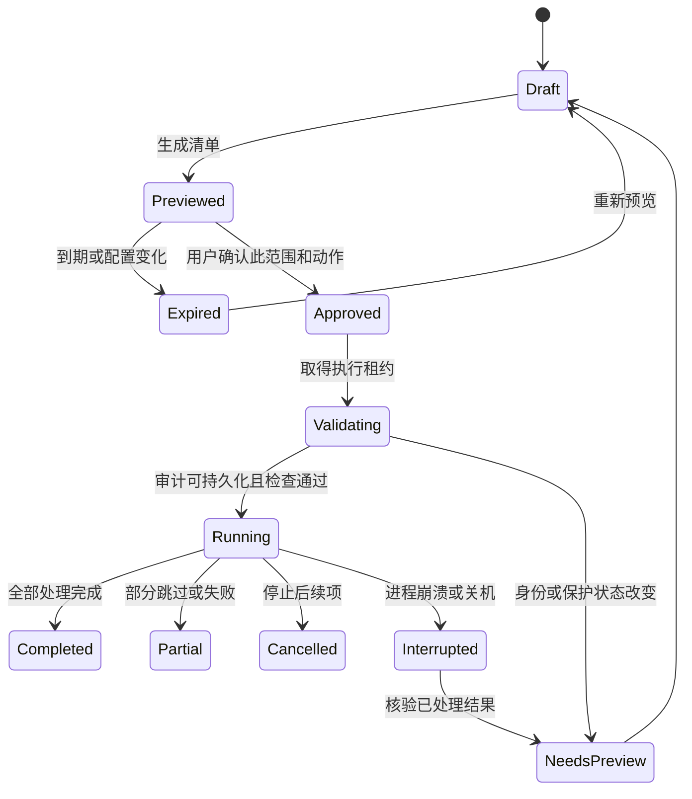

# 安全清理协议

本协议约束手动清理、一键清理和后续任何后台清理。归因用于解释，不能单独授权删除。

## 1. 清理对象分级

| 类别 | 例子 | 默认处理 |
| --- | --- | --- |
| 已验证、独占、可重建缓存 | 经版本验证的特定缓存子目录；CClean 已关闭临时文件与过期日志 | 用户启用规则后，可进入一键预览 |
| 共享可重建缓存 | npm、pip、uv 等工具缓存的候选类别 | 标为共享，首版默认排除一键；独立预览并逐次确认 |
| 项目依赖与构建产物 | `node_modules`、`.venv`、`target`、`build`、`dist`、`bin`、`obj` | 只提供有依据的逐项预览，活动项目保护 |
| Agent 持久数据 | 会话、记忆、检查点、补丁、工作区副本、配置 | 默认保护，首版不提供泛化删除规则 |
| 源码与用户数据 | `.git`、源码、锁文件、文档、下载、密钥与凭据 | 默认保护，批量全选不能绕过 |
| 系统与特殊对象 | Windows 系统目录、页面/休眠文件、WSL/Docker 磁盘、链接和云占位 | 只展示或引导官方管理工具，首版不直接清理 |
| 来源未知 | 未验证工具版本、模糊名称、归因不足的目录 | 仅展示和解释；首版所有清理入口均跳过，手动选择也不能绕过 |

命名为 `cache` 或 `tmp`、长时间未修改、被 Git 忽略，都不构成充分删除依据。不得把 `.codex`、`.claude`、ZCode 数据根目录、整个 `AppData` 或 `%TEMP%` 加成递归清理白名单。

## 2. “与当前开发无关”的判定

满足以下全部条件才可进入常规一键候选：

1. 对象在用户明确启用的已验证规则范围内，且可重建性和清理动作有实测依据。
2. 与所有已登记的活跃项目、会话、工作树及其依赖范围均不相交。
3. 不属于共享资源或未知来源；共享缓存使用单独的、逐次确认的入口，不伪称无关。
4. 未检测到使用该缓存的工具或相关写入活动；观察能力不足时保守排除。
5. 不触及系统、用户资料、源码、凭据、Agent 历史或显式保护规则。
6. 文件身份、元数据、路径边界和规则版本在执行前仍与预览相符。

这些判断仅覆盖已登记和可观察范围，界面需显示该范围。用户显式结束会话只是活动信号之一，不能证明所有依赖都已不需要。近期无写入只是辅助证据。

## 3. 缓存规则契约

每条规则至少声明：规则 ID 与版本、支持的工具版本、缓存根的可靠发现方式、对象类型、可重建依据、活动检查、保护排除、最低保留期、执行动作、离线/再下载代价、预览粒度、验证用例与最后验证时间。

适配器可以从用户选择或公开支持的配置命令发现路径。执行外部命令时绑定已确认的可执行文件路径和固定参数，不拼接 Shell 字符串，不执行缓存目录内的任意程序。

首批研究对象为 Codex、Claude Code、ZCode 的已证实可重建子目录，以及 npm/pip/uv 缓存机制；这些仅是候选，不是已批准白名单。M0 至少确定一个可进入常规一键的真实外部独占缓存规则；若某规则只能整体清理，应明确显示整项影响范围并归入单独确认流程，不能用它替代外部一键规则门槛。

包管理器原生命令优先作为机制研究，但不能因其“官方”就假装它遵循 CClean 的逐文件清单。如果命令会删除预览后新增对象，且无法隔离或锁定写入范围，就不能接入首版执行器，只提供说明/跳转。首版执行入口必须通过相同的范围一致性门槛。

默认启用的规则仅覆盖 CClean 自身已关闭临时文件和到期日志；外部规则必须由用户启用。MVP 验收要求至少一个外部规则满足常规一键安全条件，而不是通过默认勾选或共享缓存手动清理来凑清理量。

## 4. 预览协议

预览应生成一次性清单，包含：

- 清单 ID、创建时间、默认 5 分钟有效期、规则与保护配置版本。
- 每个候选的卷标识、File ID、创建/修改信息、大小、链接数、数据流检查结果与关键属性。
- 观察到的路径、批准根目录及边界信息、归属依据、活动状态。
- 执行动作、不可恢复性、估算占用、恢复所需下载/重建代价。
- 排除项和原因；未知估算不能填成零并并入确定总数。

不允许“预览目录大小后直接递归删除整个目录”。清单列举到具体对象；目录只有在所有已批准内容完成后、确认仍为空时才可尝试删除，新产生的内容不自动加入。

改变勾选范围、规则、活动状态或保护设置使有关清单失效；到期必须重新预览。按钮同时表达对象数、估算值与删除方式，不能只显示一个醒目的“清理”。

## 5. 执行协议

1. 同一时间仅允许一个清理任务，使用任务和清单标识避免重复执行。
2. 先持久化清单、用户批准范围与任务开始记录；磁盘已满或 DB 不可写时不开始删除。
3. 每个对象执行前重新检查活动状态、保护版本、元数据、文件身份和根目录边界。变化项跳过，范围整体失效则结束任务要求重新预览。
4. 不能只做字符串前缀检查。以句柄读取卷/File ID、最终路径与属性，验证路径组件及祖先链，不跟随 reparse point，不跨越授权根。
5. PoC 必须验证“按已验证对象执行”的 Windows 句柄方案：打开时限制共享写入/删除，必要时稳定祖先目录句柄，在同一身份句柄上检查并执行删除标记。无法稳定对象或发现不兼容共享句柄时直接跳过。
6. 路径式 `File.Delete` 前加一次 `Exists`/时间比较并不能消除 TOCTOU 竞态，不能作为 G2 通过依据。具体 Win32 flags/API 经实测确定；未通过前只开放 dry-run。
7. 首版所有清理入口跳过多硬链接、reparse point、特殊稀疏/压缩对象、云占位文件、含命名数据流或数据流枚举失败的对象。流检查必须在执行前复核，不能只靠预览时的默认流大小。普通路径也要覆盖中文、长路径、大小写与边界相似目录。
8. 遇到锁定、权限不足、身份变化或新活动，逐项记录原因并跳过；不提权强删、不终止开发进程、不安排重启删除。
9. 每个结果在下一步执行前持久化。支持取消，取消只停止尚未开始的项；已永久删除对象不会因取消而恢复。
10. 结束时复查受影响目录并采样系统可用空间，报告完成、待释放、跳过与失败，不能默认所有估算值都已兑现。

文件校验、活动观察和工具适配不能形成绝对的全系统业务锁，因此高不确定性对象始终排除。首版发布以受支持的受控规则为边界。

## 6. 删除方式与恢复边界

| 操作 | 是否立即释放 C 盘 | 恢复能力 |
| --- | --- | --- |
| 永久删除已确认缓存 | 通常释放，可能受句柄和链接影响而延迟 | 不保证恢复；可重建不等于能找回原内容 |
| 移入 C 盘回收站 | 通常不释放 C 盘 | 由系统回收站条件决定 |
| 同盘隔离目录 | 通常不释放 C 盘 | 能移回不代表空间已释放 |
| 转移到其他磁盘 | 成功校验并移除源后可能释放 | 需要目标容量、完整性与恢复协议，列为 P2 |

首版的一键释放使用明确告知的永久删除，只针对已批准规则。规则启用说明和每次预览都必须表明删除方式。回收站若作为以后可选操作，必须单独标记“不会立即释放 C 盘空间”。

## 7. 崩溃、审计与幂等

- 每项记录 `pending / started / deleted / pending-release / skipped / failed`；任务级状态与逐项结果分开。
- 崩溃发生在删除完成、结果未落盘之间时，启动后重新核验身份：对象已缺失只能记为“恢复时发现缺失”，不能确定归因于上次操作或虚构释放量。
- 重启后展示中断任务，不自动续删；剩余对象重新预览和确认。
- 审计记录包含规则版本、依据、动作、时间、错误码和清理前后可用量，不保存文件内容或秘密。
- 审计写入中途失败则停止后续清理，保持可见错误；不可用内存日志替代永久操作所需的可靠记录。

## 8. 安全验收门槛

必须测试路径替换、父目录替换、预览后新增文件或命名数据流、junction 越界、符号链接、硬链接、未知来源手动/全选绕过、共享缓存仍活跃、占用/拒绝访问、进程复用、超时清单、并发点击、取消、崩溃和审计磁盘满。所有保护对象和清单外对象保持不变。

只要出现一次越界或误删，执行器保持关闭，修复并重跑相关对抗测试。完整用例矩阵见 [开发执行计划](05-delivery-plan.md)。
