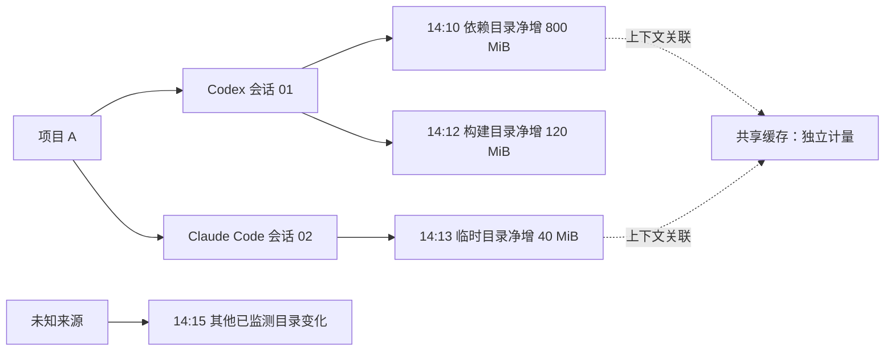

# 界面与交互规划

本文件为信息架构与低保真交互说明，不是已实现界面。示例大小、项目和会话全部为合成数据。

## 1. 界面原则

以桌面数据工作台为方向：清楚显示空间、时间、来源依据和动作后果。浅色与深色主题共用语义色；不依赖透明模糊或持续动画，减少干扰和资源消耗。

UI/UX 技能检索中，已采用与本产品匹配的 Data-Dense Dashboard 建议：指标行、筛选、可排序表格、清晰加载状态与虚拟化。通用落地页、玻璃效果和在线字体建议不适合本地磁盘工具，因此不纳入方案。

默认使用系统中文字体和等宽数字，路径支持复制与完整展开。状态同时有文字和图标，不能只靠红/绿区分。所有核心操作支持键盘，焦点可见；桌面最低目标 1024×720，验证 125%/150%/200% DPI。

## 2. 页面结构

| 页面 | 主要内容 | 主要动作 |
| --- | --- | --- |
| 总览 | C 盘可用量、监测范围、净增长、候选估算、增长目录排名 | 登记项目、定位时间线、生成清理预览 |
| 开发时间线 | 项目泳道、会话分支、文件变化簇、采集缺口 | 时间筛选、选择节点、查看关联依据 |
| 文件与空间 | 虚拟化目录/文件列表、占用与变化排序 | 搜索、筛选、加入预览、保护目录 |
| 清理中心 | 一键候选、逐项候选、受保护/未知对象、排除原因 | 生成预览、执行已批准清单 |
| 清理记录 | 成功/跳过/失败/中断任务、前后容量 | 查看逐项记录、重新预览剩余项 |
| 项目与设置 | 目录登记、会话、缓存规则、预算、告警、隐私 | 开始/结束会话、启用规则、调整保留期 |

## 3. 主界面线框

```text
┌──────────────────────────────────────────────────────────────────────────┐
│ CClean       C: 可用 18.4 GiB / 200 GiB     最近更新 14:32:08   [暂停采集] │
├────────────┬─────────────────────────────────────────────────────────────┤
│ 总览       │ 已监测占用      今日净增长      可清理估算     覆盖状态       │
│ 开发时间线 │ 32.1 GiB        +4.2 GiB        0.8–1.0 GiB   12/13 个根目录 │
│ 文件与空间 ├─────────────────────────────────────────────────────────────┤
│ 清理中心   │ [项目: 全部] [工具: 全部] [时间: 最近 1 小时] [依据: 全部]    │
│ 清理记录   │                                                             │
│ 项目与设置 │ 项目 A ──● 会话 01 ──● 依赖缓存变化 ──● 构建产物变化        │
│            │         └● 会话 02 ─────● 临时文件变化                      │
│            │ 共享缓存 ─────◇ 多个会话关联                                │
│            │ 来源未知 ───────────? 未关联变化                             │
│            ├─────────────────────────────┬───────────────────────────────┤
│            │ 增长目录排名                │ 所选节点：构建产物变化         │
│            │ 路径 / 占用 / 净增长        │ 依据：登记路径 + 会话时间      │
│            │ 可排序、分页、快捷搜索      │ 状态：活跃项目，受保护         │
│            │                             │ [查看文件] [加入清理预览:禁用] │
└────────────┴─────────────────────────────┴───────────────────────────────┘
```

上述 `12/13` 只代表登记目录状态，不能展示成“全盘扫描 92%”。文件数与占用均需说明计量范围。共享节点只算一次全局占用。

## 4. Git 式时间线的确切语义



- 横轴是时间；项目是泳道，会话从项目锚点分出。重叠会话保持独立，不假装存在 Git merge。
- 节点默认按“会话 + 目录 + 变化类别 + 时间桶”聚合；缩小时扩大时间桶，最多显示 500 个可见节点。
- 点击节点展开文件列表、大小前后值、估算占用、归因依据、活动状态、规则与排除原因。
- 直接进程证据、上下文关联和共享关系采用不同线型及文字；“未知来源”有独立泳道，不隐藏。
- 在观察窗口开始前已存在的文件标为“初始存量”，不能算作本次会话创建。
- 监测缺口使用带说明的时间带；暂停采集、扫描中和数据过期分别标识。
- 历史节点是聚合元数据快照。旧文件已删除或移动时显示历史状态；不能从旧节点直接删除当前同路径的新文件。
- 当前执行对象必须重新从文件索引与文件系统生成预览；历史图不提供“撤销写入”按钮。

## 5. 首次使用流程

1. 展示 C 盘总量和可用量，说明本地处理及初始监测范围。
2. 用户登记项目；允许项目位于其他盘。不了解 C 盘相关目录时，可先确认一个个人工具数据目录范围，执行可取消、分批限额的只读发现，查看当前已扫描部分的占用候选。
3. 选择工具标签 Codex、Claude Code、ZCode 或通用工具，检查版本适配能力。
4. 用户从发现结果、经过验证的建议或手动路径确认监测目录；显示未扫描范围。无法确认的工具数据根只观察，不能自动转成可清理缓存。
5. 后台建立基线，界面显示已覆盖目录、权限不足和进度；总览立即可用。
6. 开始手动会话或使用经过验证的启动绑定，进入时间线。
7. 用户查看缓存规则说明并选择启用。默认不会删除外部文件。

首次使用不要求管理员权限。点击增强采集时再说明能力、范围与系统提权；拒绝后保持目录监测。

## 6. 手动清理与一键清理

**从节点手动清理：** 选择当前文件 → 查看保护/风险 → 加入预览 → 执行前确认。受保护或未知对象展示原因和管理入口，但不能在弹窗中临时绕过保护。

**一键清理：** 总览点击“一键清理” → 系统计算所有已启用规则的合格候选 → 显示统一预览 → 用户一次确认批量执行。“一键”指自动汇集和批量操作，不代表省略用户已要求的预览。

预览固定展示：范围与规则、文件数量、占用估算及不确定项、永久删除提示、重建/再下载影响、排除数量、清单有效期。按钮示例：“永久删除 246 个已确认缓存文件（估算 820 MiB）”。

共享缓存采用单独的“共享缓存检查”入口，说明可能影响其他项目与离线使用。整体工具清理操作只有通过范围一致性验证才可执行，否则提供操作说明，不假装支持勾选部分文件。

执行页面显示已处理/跳过/失败数量、当前动作、取消按钮。结果分列“删除对象估算占用”和“系统可用量变化”，提示并发写入会影响后者。

## 7. 关键状态与反馈

| 状态 | 界面必须表达 | 可用操作 |
| --- | --- | --- |
| 无监测项目 | “尚未登记目录” | 登记项目、查看容量 |
| 初始扫描 | 已覆盖范围，历史尚未建立 | 暂停、取消、继续使用其他页面 |
| 无权限 | 具体根目录与原因，不显示成空目录 | 忽略、移除范围、查看权限说明 |
| 事件丢失 | 缺口范围、正在校准当前状态 | 查看详情，不伪造历史 |
| 无可清理项 | 按活跃、共享、未知、受保护分组解释 | 管理规则、查看空间排名 |
| 清单已过期 | 哪些条件变化或何时到期 | 重新预览 |
| 部分完成 | 成功、跳过、失败及原因 | 查看结果、重新预览剩余项 |
| 紧急低空间 | 可用量、采集已降级、自身写入已受限 | 从已有索引预览、打开 Windows 存储设置 |
| 审计不可写 | 无法可靠记录清理，执行被阻止 | 查看容量与错误、使用系统清理工具 |

## 8. 交互验收

所有清理操作均有键盘可达路径、焦点恢复与明确的取消行为；没有只能 hover 才能看到的关键依据。表格提供时间线的替代操作入口；正文对比度至少 4.5:1，状态图形可通过文字理解。

界面聚合更新、离屏停止绘制、隐藏窗口降低刷新频率。动画仅用于理解状态变化，尊重减少动态效果设置，不持续滚动大量事件。空状态、错误态、缺口态和低空间态应作为原型及最终验收的必测页面。
