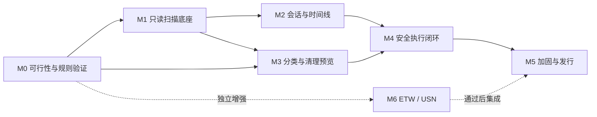

# 开发执行计划

版本：0.1 · 本次交付仅完成规划与 GitHub 同步。下列应用开发任务均尚未开始，不以文档存在代替功能完成。

## 1. 阶段与依赖

M2 与 M3 在索引和查询契约稳定后可以并行。M4 必须等保护、活动状态和预览契约都可验收后再开放真实删除。M6 不阻塞普通模式的 MVP，但精确进程归因的宣传必须等 M6 通过。

| 阶段 | 人日估算 | 主要结果 | 完成状态 |
| --- | --- | --- | --- |
| 规划与仓库 | 本次 | 需求、架构、清理协议、UX、任务与来源 | 文档已编制，远端以实际提交为准 |
| M0 | 4–6 | 监测、计量、删除身份与外部缓存规则 PoC 报告 | 未开始 |
| M1 | 4–6 | 可取消扫描、索引、容量总览、自身预算 | 未开始 |
| M2 | 5–7 | 项目/会话、工具基础适配、聚合时间线 | 未开始 |
| M3 | 4–6 | 分类、保护规则、清理 dry-run | 未开始 |
| M4 | 5–8 | 受控执行、审计、恢复与空间复测 | 未开始 |
| M5 | 4–6 | 性能、低空间、真实工具验收、Windows 安装包 | 未开始 |
| M6 | 5–8，独立估算 | ETW 精确归因与 USN 补扫增强 | 未开始 |

普通模式 MVP 预计 26–39 个工程人日，约 6–8 周单人全职投入，包含基础测试和文档更新；这是风险估算，不是排期承诺。签名证书、工具版本变化、权限兼容或 G2/G3 不通过会增加时间。多 Agent 可以并行准备界面与规则，但不能用并发替代 Windows 实机验证。

## 2. M0：先验证最容易推翻方案的部分

| 任务 | 操作与产出 | 准入标准 |
| --- | --- | --- |
| T00 | 固定 Windows 11 x64/NTFS 测试环境，准备合成数据和工具版本清单 | 不使用真实开发资料做破坏性测试 |
| T01 | 最小目录扫描/监听探针；创建、追加、覆盖、截断、移动、删除 | 静默后清单和大小与独立枚举 100% 一致 |
| T02 | 人为产生通知缓冲溢出、目录整体移动、监测重启 | 显示缺口；受控 100,000 文件集静默后目标 60 秒内收敛 |
| T03 | 对比逻辑大小、分配估算、硬链接和系统可用量 | 同一身份不重复统计；不支持的对象明确未知 |
| T04 | 句柄式身份复核与受限删除 PoC，模拟叶子/祖先目录替换、数据流变化和写入竞态 | G2：保护对象、清单外对象和越界对象删除数为 0 |
| T05 | 三工具版本/运行方式调查，验证至少一个外部常规一键缓存规则 | G3：真实外部独占缓存的可重建性、活动排除、范围控制与清理结果均通过 |
| T06 | SQLite+WAL 压力与低空间模拟，校准资源指标 | 有界增长；审计不可写时禁止启动删除 |

M0 产出拟保存为 `docs/research/monitoring-poc.md`、`cleanup-poc.md`、`tool-compatibility.md`，只保留脱敏结果和合成数据。报告必须区分成功范围、失败场景和未验证假设。

G2 未通过：继续只读监测与预览，不能启动真实清理开发验收。G3 未通过：继续验证可支持的较窄外部规则，明确一键清理尚未达到 MVP；不能静默用“只清自身日志”或“共享缓存单独确认清理”替代。若 .NET/WPF 出现实测阻碍，记录比较证据后修订架构决定。

## 3. M1：只读底座

1. 建立 .NET 10 解决方案、WPF 启动程序、Core 和关键测试工程；锁定 SDK 与依赖版本。
2. 添加 Windows CI 的构建与测试步骤，不提前加入与阶段无关的框架。
3. 实现容量采样、有预算的只读目录发现、用户确认登记、文件身份读取、异步基线扫描、进度与取消。
4. 建立最小 SQLite schema、迁移与重建策略、批量更新、容量守卫。
5. 接入有界监听队列、去抖、dirty 根补扫、覆盖状态和启动恢复。
6. 构建只读总览与文件列表，展示真实采样时间和完整性。

验收：FR-01～03、FR-12 基础能力通过；没有任何真实删除入口；10 分钟空闲资源和 100,000 文件扫描有可复现报告。

## 4. M2：会话、归因和可视化

1. 实现项目/会话状态机，手动开始、结束及程序异常退出处理。
2. 实现 Codex、Claude Code、ZCode 的 A 级适配；逐版本验证可执行程序和启动绑定后再开 B 级能力。
3. 建立上下文关联、共享与未知分类；保证同一文件的全局占用只统计一次。
4. 实现按目录和时间桶聚合的时间线，最多 500 个可见节点，列表虚拟化。
5. 增加范围/工具/时间筛选、历史缺口、来源依据详情和增长排名。
6. 为活动保护提供查询契约；不能从“进程退出”直接推断可清理。

验收：FR-04～07、FR-13 通过；三工具均可经手动会话和登记目录工作；并发会话与共享缓存不错误分配成独占来源。

## 5. M3：规则、保护与预览

1. 将 M0 确认的外部规则写成版本化规则，默认关闭；自身规则设置明确保留期。
2. 实现受保护根、活动项目/依赖、特殊对象与未知来源的排除。
3. 生成带到期时间、配置版本、文件身份与动作的一次性清单。
4. 提供节点手动加入预览和规则批量生成预览两个入口。
5. 展示所有排除原因、永久删除方式、重建影响与估算不确定性。
6. 先让执行器只输出 dry-run 结果，用安全测试覆盖每类候选与排除项。

验收：FR-08～09 通过；任何入口和全选操作都不能绕过保护；在完全相同文件状态下预览结果可重复，状态改变时可检测失效。

## 6. M4：安全执行与闭环

1. 在 G2 已通过方案上实现单清理任务租约、批准清单绑定与前置审计。
2. 逐项重新验证，按已验证对象执行，锁定/变化/权限不足时跳过。
3. 持久化逐项结果，支持取消；在关键位置注入崩溃测试。
4. 重启只恢复结果与待复核状态，不自动续删。
5. 复测受影响范围与系统可用量，将操作完成、待释放和并发空间变化分开显示。
6. 对经过验证的外部工具真实缓存执行受控清理，重新运行工具验证可重建性。

验收：FR-10～11、FR-14 及清理矩阵全部通过。至少一条真实外部独占缓存规则在满足条件时可进入常规一键清理；共享缓存必须单独确认，不得用该流程替代 FR-14，也不得错误标为与开发无关。

## 7. M5：加固与发行

1. 跑资源、中文/长路径、DPI、键盘、空/错/缺口状态测试。
2. 使用受控限额卷或虚拟机模拟空间不足、审计写失败、日志错误风暴和 DB 损坏；禁止填满日常开发机的 C 盘。
3. 对普通用户权限和拒绝提权情况验收，确保仍可使用基础功能。
4. 完成安装/升级/卸载和数据库迁移验证；卸载只处理应用本身数据，不触及被监测目录。
5. 确定签名和发布渠道；发布未签名内部测试包时如实标记，不宣称系统已信任。
6. 输出兼容表、已知限制、用户手册、隐私说明和更新记录。

发布条件：P0 全部通过；误删/越界用例为 0；容量预算与低空间降级可验证；安装包与实际测试版本一致。正式发布和分发证书不包含在本次规划同步中。

## 8. M6：可选监测增强

- ETW：受控父子进程、PID 复用、长寿命句柄、异步 I/O、内存映射及系统延迟写分别测试；错误归因必须为 0，普通受控写入正确关联覆盖目标 ≥ 99%，其余保留未知。
- 记录 provider/session 的权限要求、事件丢失和资源消耗；不默认保存无上限 ETL。
- USN：读取现有 journal，保存卷/JournalId/NextUsn，验证重建、截断、游标过期；不自动创建、扩大或删除系统 journal。
- 两种增强都不能保证工具聊天会话归因；仍需已验证的会话绑定。
- 不满足指标则保留普通模式，不能把 P0 的上下文关联重新标成进程证实。

## 9. 关键验收矩阵

| 编号 | 场景 | 必须达到的结果 | 阶段 |
| --- | --- | --- | --- |
| AT-01 | 增删改、重命名、目录整体移动 | 静默后状态一致，无重复占用 | M0/M1 |
| AT-02 | 缓冲溢出、暂停、重启、监听间隙 | 缺口可见；补扫只恢复当前状态 | M0/M1 |
| AT-03 | 项目位于其他盘，缓存写 C 盘 | 关联可见；C 盘指标不混入其他卷 | M1/M2 |
| AT-04 | 两个项目同时使用缓存 | 共享归因、去重计量、默认不进一键 | M2/M3 |
| AT-05 | 同路径文件在预览后被替换 | 身份不匹配，跳过 | M0/M4 |
| AT-06 | 祖先目录替换、junction、符号链接、硬链接 | 不跟随、不越界、不误计可释放量 | M0/M4 |
| AT-07 | 预览后新增文件/源码 | 新文件不被执行清单删除 | M3/M4 |
| AT-08 | 预览后项目重新活动、进程复用 | 受影响项失效；不强杀进程 | M2/M4 |
| AT-09 | 文件被占用、ACL 拒绝、中文和长路径 | 正确处理或跳过，错误原因可见 | M0/M4 |
| AT-10 | 清单过期、配置变化、重复点击执行 | 重新预览或复用已执行结果，无重复删除 | M3/M4 |
| AT-11 | 永久删除、待句柄释放、并发写盘 | 操作结果和系统可用量分别报告 | M4 |
| AT-12 | 取消/崩溃发生在删除前后不同点 | 保存已知结果，未知明确标注，不自动续删 | M4 |
| AT-13 | DB/WAL/日志逼近预算、审计磁盘满 | 降级、停止扩展；不可审计时不新删 | M1/M5 |
| AT-14 | Agent 持续高速写入、C 盘告急 | 及时提示、自身限写，不报告虚假的空间保障 | M5 |
| AT-15 | 外部缓存规则与工具版本变化 | 已支持版本可重建；未支持版本保守回退 | M0/M4/M5 |
| AT-16 | WSL/Docker/云盘特殊数据 | 只展示支持范围，不进入首版直接清理 | M1/M3 |
| AT-17 | 大量节点、高 DPI、键盘导航 | 聚合/虚拟化生效，功能可用且焦点可见 | M2/M5 |
| AT-18 | ETW 丢失、PID 复用、映射写；USN 游标失效 | 不错误归因，缺口可见，可回退 | M6 |
| AT-19 | 已有/新增 ADS，数据流枚举失败 | 标记计量不完整，所有清理入口跳过 | M0/M4 |
| AT-20 | 未知来源被逐项勾选或全选 | 不绕过保护，明确解释不可清理 | M3/M4 |
| AT-21 | 首次不知缓存位置，发现任务超时或取消 | 显示部分结果与覆盖，只有用户确认才加入监测 | M1/M2 |

## 10. 开发工作流与变更控制

每阶段使用短期功能分支，提交具体问题、行为变化与相关验证结果，再通过 PR 审阅。先跑与变更相关的测试，达到阶段门槛后才扩大到发行测试；不为文档修改添加镜像测试。

涉及删除边界、权限、规则范围或会话归因语义的变化，必须同步修改需求/协议与相应安全用例。默认不提交实机数据库、事件记录、绝对路径清单、凭据或聊天数据。

PR 应关联 FR/AT 编号，说明已测和未测范围。CI 在应用代码建立后执行 Windows 构建和非破坏性测试；管理员权限、低空间和真实工具清理在隔离 Windows 环境进行。

## 11. 回退策略

监测失效可回退到只读扫描；增强采集失败可回退普通模式；预览不可靠则禁用执行。删除执行本身没有通用回滚，永久删除必须在之前的验证与批准阶段控制风险。

应用升级失败时保留旧版本与可读的元数据迁移信息；数据库重建只能影响 CClean 自己的索引。不能通过“恢复环境”或卸载应用来触碰被监测项目。
